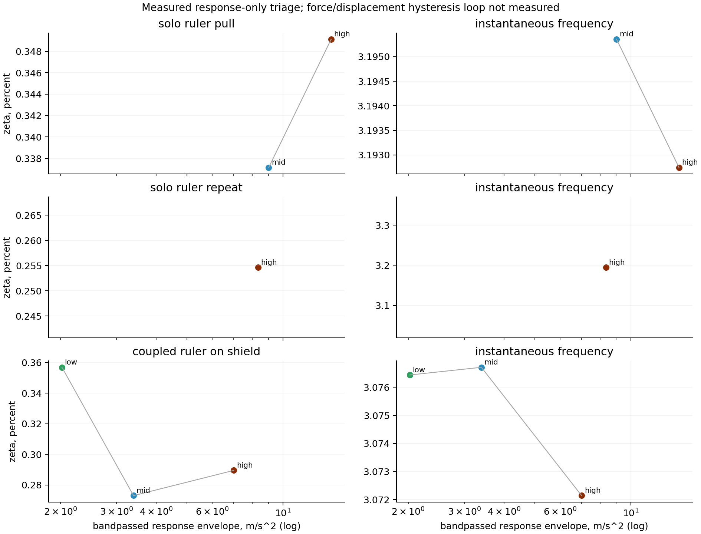
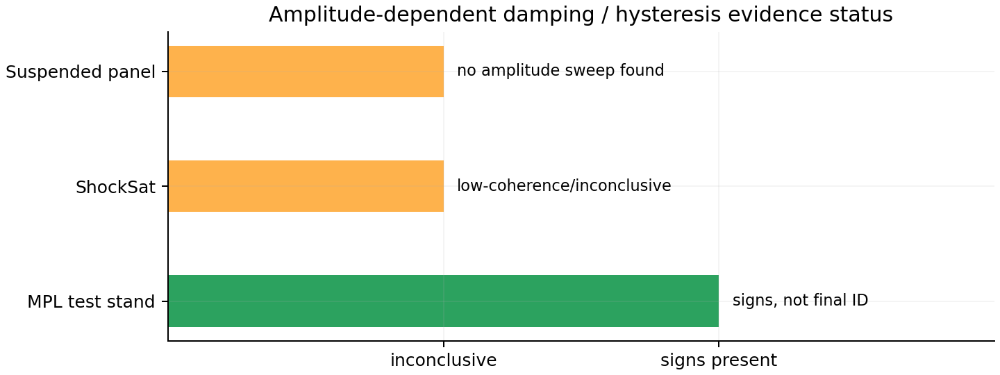

# Amplitude-Dependent Damping / Hysteresis Scan

## Bottom Line

- **MPL test stand: YELLOW, weak signs present.** The response-only pull-release data show small harmonic content that is consistently larger in the high-amplitude part of the decay; the coupled-ruler damping/frequency shifts are modest. This is evidence worth following up, but not a calibrated hysteresis loop because the pull force/displacement loop was not measured.
- **ShockSat: YELLOW, inconclusive.** Four hammer hits have force-amplitude contrast, but the existing H1 accelerance estimates have median coherence around 0.05-0.06 in 100-10,000 Hz and unresolved source/response mapping, so per-hit FRF differences cannot be trusted as nonlinear damping evidence.
- **Suspended panel: YELLOW, inconclusive.** The folder has LDV frequency-domain products (`H1`, acceleration, frequency), but I did not find repeated drive-amplitude levels or raw time histories needed to test amplitude dependence.

**Overall status: YELLOW.** At least one dataset shows signs, but no dataset here proves hysteresis in the strict force-displacement energy-loop sense.

## MPL Numerical Screen

| case | high zeta % | low zeta % | high-low freq shift % | early harmonic/fundamental | late harmonic/fundamental | interpretation |
| --- | ---: | ---: | ---: | ---: | ---: | --- |
| MPL solo ruler pull | 0.349 | nan | nan | 6.24e-05 | 1.3e-05 | response-only nonlinear screen |
| MPL solo ruler repeat | 0.255 | nan | nan | 0.000324 | 9.27e-06 | response-only nonlinear screen |
| MPL coupled ruler on shield | 0.29 | 0.357 | -0.14 | 0.000169 | 1.51e-05 | response-only nonlinear screen |

## ShockSat Numerical Screen

- Loaded Test07 hammer hits: `4`.
- Hammer force peak range: `0.718` to `1.33` lbf; max/min ratio `1.85`.
- Median coherence by selected channel:
  - `ch1`: median over hits `0.0564`; force-vs-median-|H1| Pearson `0.343` (not trusted because coherence is low).
  - `ch50`: median over hits `0.0545`; force-vs-median-|H1| Pearson `0.0684` (not trusted because coherence is low).
  - `ch87`: median over hits `0.0559`; force-vs-median-|H1| Pearson `0.12` (not trusted because coherence is low).

## Suspended Panel Numerical Screen

- `H1.mat` shape: `[25, 3200]` response points x frequency lines.
- Frequency range: `0.125` to `400` Hz.
- Dominant H1 peak frequencies across response points span `0.75` to `123` Hz.
- Limitation: these are frequency-domain products, not a documented amplitude sweep.

## Next Measurement To Turn Yellow Into Green

- MPL: repeat the ruler/stand pull or tap at planned amplitude levels with displacement or force measurement, then fit damping/frequency versus amplitude and plot force-displacement or force-velocity loops.
- ShockSat: use a valid modal/hammer dataset with high coherence, mapped source/response grids, and intentionally varied hammer levels; then compare FRFs and modal damping by input level.
- Suspended panel: locate or run stepped-sine/random tests at multiple drive amplitudes with the same LDV points; compare modal peak frequency, bandwidth, phase, and H1/H2/coherence by level.
