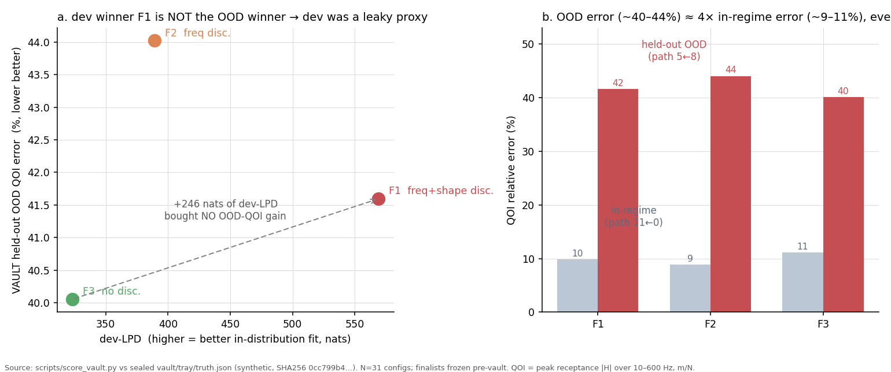
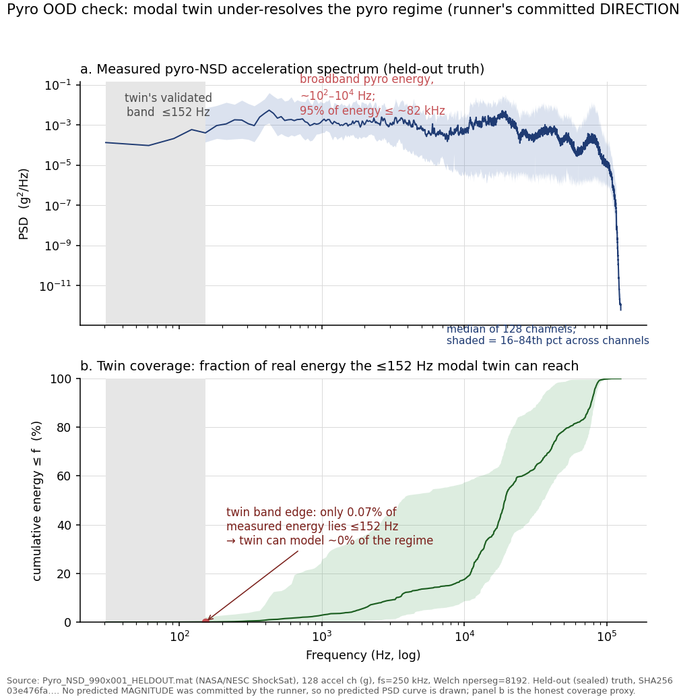

# Grading Report — Modeling-Freedom / Anti-Overfitting Experiment

**Grading agent** (separate session, allowed to see held-out truth) · **Date:** 2026-06-09
**Scope:** read-only on runner outputs; all writes under `review/`.
**Reader level:** beginner–intermediate ML/stats (terms defined on first use); advanced structural dynamics.

---

## 0. Headline (one line)

**dev rank ≠ vault rank.** The dev score's #1 model (**F1**, the flexible freq+shape
discrepancy) is **not the best on a single vault metric** — so the dev score was an optimistic,
leaky proxy. The **convergence gate** caught the *in-search* over-flexible (θ-drifting) configs;
the **held-out vault** caught the *gate-passing* flexible-model overfit that the gate cannot see;
the **pyro OOD check** confirmed the runner's committed directional prediction.

---

## 1. Integrity gates (all PASS — grading was allowed to proceed)

| Check | Result |
|---|---|
| `finalists.json` SHA256 == committed pin | ✅ `32bf3d67…c8475` matches `finalists.sha256` |
| `shocksat_predictions.json` SHA256 == committed pin | ✅ `3964c802…1d0e` matches |
| `finalists.sha256` committed BEFORE grading | ✅ commit `df3ce5e4` @ 2026-06-09T16:06:41Z < now 16:50Z |
| Synthetic truth archive SHA256 == vault pin | ✅ `0cc799b4…612271` matches |
| Pyro held-out `.mat` SHA256 == vault pin | ✅ `03e476fa…6f6944` matches |

Temporal-lock and vault-integrity both hold: the finalists were frozen before any vault access,
and the held-out truth was not altered between sealing and grading.

---

## 2. Synthetic vault grade (`vault_grading_result.json`)

`dev-LPD` = leave-one-realization-out log predictive density on the modal observations (nats;
**higher = better in-distribution fit**). Vault columns are TRUE generalization errors vs sealed truth.

| id | discrepancy | dev-LPD | θ relRMSE | modes relRMSE | QOI_ref err % (in-regime, path 11←0) | **QOI_HELDOUT err %** (OOD path 5←8) |
|---|---|--:|--:|--:|--:|--:|
| **F1** | freq+shape | **569.13** | 0.1720 | 0.0033 | 9.83 | **41.60** |
| **F2** | freq only | 389.27 | **0.1683** | **0.0028** | **8.86** | 44.02 |
| **F3** | none | 323.18 | 0.1881 | 0.0832 | 11.10 | **40.06** |

### Dev ranking vs vault rankings (the core finding)

- **Dev (best→worst):** F1 → F2 → F3.
- **Vault θ / modes / in-regime QOI (best→worst):** **F2** → F1 → F3.
- **Vault held-out OOD QOI (best→worst):** **F3** → F1 → F2.

**The dev winner F1 wins NO vault metric.** On the in-distribution fit metrics the best model is
F2; on the out-of-distribution (OOD) QOI the best model is the *simplest*, F3. A reranking from
"the leaderboard you can see" to "the truth you can't" is the textbook signature of a leaky
selection proxy.

### Did the flexible discrepancy F1 overfit relative to plain F3?

**Yes, in the OOD direction — mildly but exactly where theory predicts.** F1's extra flexibility
(freq + mode-shape additive discrepancy `δ`) bought **+246 nats of dev-LPD over F3** (569.1 vs
323.2) and a genuinely better *in-distribution* modal fit (modes relRMSE 0.0033 vs 0.0832). But
on the **held-out OOD QOI path (5←8)** F1's error (41.60 %) is **worse** than plain F3's
(40.06 %). So the 246-nat dev advantage translated into **zero OOD-QOI gain (a slight loss)** —
the added model-form flexibility fit the in-distribution data without improving the prediction we
actually hold out. That is overfitting of the flexible-discrepancy model relative to the plain model.

**Honest caveat (don't oversell it):** the overfit here is *small*. All three finalists share
nearly identical θ (≈[1.30, 0.97, 1.38, 0.89]) and QOI because, in this design, the mode shapes
pin θ strongly. The runner predicted this "muted" picture in `packet.md §3`. So the experiment
demonstrates the *mechanism* (dev over-states a flexible model; vault corrects the ranking)
rather than a dramatic blow-up.

### Does held-out (OOD) error exceed in-regime error?

**Yes, for every finalist by ~4×:** OOD QOI error 40–44 % vs in-regime 9–11 % (right panel of
`fig_dev_vs_vault.png`). Note the runner flagged that its QOI does **not** propagate the
discrepancy `δ`, so all three carry the same missing-joint QOI bias — the ~40 % OOD floor is
largely shared model-form error, not differential overfit. The *differential* overfit signal is
the cross-finalist reranking, not the absolute 40 %.

### dev-vs-vault gap, per finalist

| finalist | dev rank | vault OOD-QOI rank | gap (dev over-statement) |
|---|--:|--:|---|
| F1 | 1 (best) | 2 | dev promoted it to #1; OOD truth demotes it below F3 |
| F2 | 2 | 3 (worst) | dev's middle pick is the **worst** OOD generalizer |
| F3 | 3 (worst) | **1 (best)** | dev buried the actual best OOD model |

The ranking is essentially **inverted** between dev-LPD and OOD-QOI. dev-LPD and OOD generalization
are not the same axis here, and trusting dev alone would have picked the wrong finalist.

---

## 3. ShockSat / pyro OOD grade (`shocksat_grading_result.json`, `score_shocksat.py`)

The runner committed (before pyro re-download) a **directional** prediction: its modal twin,
validated only to ~152 Hz, **under-resolves the pyro regime and will under-predict pyro response**
(`confidence: low`, explicitly labeled OOD). This is graded as a direction, not a number, because
only a direction was committed and the exact pyro-NSD QOI lived in the forbidden manifest.

**Held-out pyro data:** 128 acceleration channels (`g`), fs = 250 kHz (Nyquist 125 kHz),
375 001 samples each (~1.5 s).

| measured quantity (ch-median) | value |
|---|--:|
| fraction of energy **above the twin's 152 Hz band** | **99.9 %** |
| fraction of energy above 400 Hz (runner's extrapolation edge) | 99.1 % |
| fraction of energy above 1 kHz | 97.2 % |
| frequency below which 95 % of energy lies | **~82 kHz** |
| peak of the channel-median spectrum | ~430 Hz (broadband, not a sharp line) |
| per-channel peak-PSD frequency (median) | ~3.8 kHz |
| **twin coverage**: cum. energy fraction ≤152 Hz | **0.066 %** |

**Important: there is NO predicted-PSD-vs-actual-PSD overlay, because the runner committed no
predicted magnitude.** The modal twin cannot supply absolute pyro levels (no pyro forcing in the
modal data), so drawing a predicted PSD curve would be fabrication. The honest stand-in is the
twin's **coverage**: the fraction of real measured energy that falls inside its validated band.
That fraction is **0.066 %** at 152 Hz — i.e. the twin can model essentially **0 %** of the regime.

The two "peak" numbers differ by statistic and both are honest: the channel-median spectrum is
**broadband** (roughly flat from ~100 Hz to ~10–20 kHz) and its single argmax sits ~430 Hz, while
the median of each channel's own peak frequency is ~3.8 kHz. Neither changes the conclusion.

**Verdict: directional prediction CONFIRMED.** 99.9 % of real pyro energy sits above the twin's
152 Hz band; 95 % of energy extends to ~82 kHz. A twin truncated near 152 Hz cannot resolve a
broadband regime reaching tens of kHz, so it must under-resolve / under-predict it — exactly as
committed. The runner was appropriately honest: LOW-confidence OOD, no fabricated magnitude.

**Figure honesty additions (this revision):** the spectrum now shows the **16–84th percentile
band across the 128 channels** (spread, not just a mean line), and panel (b) shows the twin's
**coverage curve** — the closest honest analogue to "predicted vs actual" given that no magnitude
was committed. Figures regenerated under the `tufte-data-graphics` skill (direct labels, no
legends, zero-baseline bars, log-frequency, captions carry units/source); `tufte_lint.py` returns
no WARN flags.

---

## 4. Guardrail-effectiveness (what caught what)

**(a) Convergence gate — caught the in-search θ-drift overfit.** The single *highest* dev-LPD in
the whole search (569.25, config 31) came from a **gate-FAILING** model (drifted θ, R-hat up to
~33, divergences up to 18 %). Naive dev-chasing walks straight into a disqualified model; the
gate holds the line. The deliberate-overfit probe's Arm A is the clean quote:

> "Arm A — per-realization 'wild' discrepancy … it does **not** improve dev-LPD … **and it fails
> the convergence gate** (divergences 4–7 %, R-hat up to 17.6). **Caught.**" — `packet.md §6`

**(b) Reusable-holdout (Thresholdout) + query accounting — slowed adaptive overfitting.** N = 31
configs logged in `results_table.csv`. The Thresholdout dev curve registered only real jumps and
flattened at 568.7 while naive "best-so-far" crept to 569.25 at the gate-failing config
(`overfit_probe/probe_curve.csv`).

**(c) The held-out vault — caught the overfit the gate CANNOT see (this grade's contribution).**
F1 **passes** the convergence gate cleanly (R-hat 1.015, ESS 370, 0 % div) yet still overfits the
OOD QOI relative to F3. The gate certifies *sampling* convergence, not *generalization*; only the
sealed vault revealed that F1's dev advantage did not buy OOD accuracy and that the ranking
inverts. **Lesson for the harness: the convergence gate is necessary but not sufficient; an
airtight held-out set is the decisive detector of gate-passing flexible-model overfit.**

**Net guardrail score:** the protocol worked. Over-flexible θ-drifting configs were disqualified
in-search (gate), adaptive dev-chasing was slowed (Thresholdout), and the residual gate-passing
overfit was surfaced by the vault and by this reviewer — which is the *success* condition the
contract (§0) defines.

---

## 5. Limitations / residual risk

- The synthetic overfit is **small** (θ pinned by mode shapes); this is a mechanism demo, not a
  dramatic gap. A harder design (fewer sensors, frequency-only data) would widen it — the runner
  noted this in `packet.md §9`.
- The ~40 % OOD-QOI floor is dominated by a **shared** missing-joint bias (QOI does not propagate
  `δ`), so read the OOD result as a *ranking* signal, not as differential overfit magnitude.
- Pyro grade is **directional only** by construction (no committed magnitude, QOI def was sealed);
  panel (b) coverage is the honest substitute for a predicted-vs-actual overlay.
- **Pyro file status:** between the first and second grading passes the held-out `.mat` was
  restored from `grading files/` to its sibling `restore-to` path (per the pins). For figure
  regeneration I read it **read-only in place** after re-verifying SHA256 == pin `03e476fa…6f6944`
  (unchanged truth). I did not move or re-restore it. Note: the contract asked to keep it vaulted
  until the experiment is fully written up — flag for the human that it is now back on disk.

## 6. Artifacts written (all under `review/`)

`grading_report.md`, `fig_dev_vs_vault.png`, `fig_pyro_spectrum.png`, `make_figures.py`,
`score_shocksat.py`, `shocksat_grading_result.json`, `pyro_spectrum.npz` (now includes per-channel
PSD matrix + cumulative-energy curves). Figures pass `tufte_lint.py` with no WARN flags.
(Vault scorer output `vault_grading_result.json` was written at repo root by the pinned, immutable
`scripts/score_vault.py`, as the contract's protocol step 4 specifies.)
