# Coverage-first validation of Bayesian finite-element model updating on a real aerospace structure: what held-out data supports — and what it falsifies

**Draft v0.3 — 2026-07-02 — for internal review (Andrew Voss). Target venue: *Data-Centric Engineering* (Cambridge University Press) or similar.**
Authors: Andrew Voss¹, [advisor(s) TBD]. ¹[affiliation].
*AI-assistance disclosure: analyses were executed by a large-language-model agent workflow under human direction, with pre-registered acceptance criteria locked by cryptographic hash (SHA-256) before each study ran; all numbers trace to archived, replayable artifacts (see Data & Code Availability).*
*Citation status: all references verified against publisher records (browser pass, 2026-07-02) except Vanik et al. (2000), flagged [VERIFY] for a final spot-check.*

---

## Abstract

Bayesian finite-element model updating — using measured vibration data to infer a probability distribution over the uncertain parameters of a structural simulation model — is typically demonstrated on simulated or geometrically simple structures, scored on the same data used for calibration, and reported when it succeeds. We report a systematic, pre-registered validation campaign on a real, professionally correlated aerospace structure: a ~406,000-degree-of-freedom NASA satellite mock-up finite-element model with a multi-reference modal test campaign. The campaign is organized around one data-centric rule: **a 95% predictive interval must contain the held-out data (a coverage gate), must widen when known information is deliberately removed (an overconfidence audit), and only then may narrowness decide** between candidate formulations. Under this rule we obtain one positive and four cautionary results. (1) A statistical-finite-element-style output-error model — a frequency-correlated, quantity-of-interest-aware multiplicative correction — delivers net interface-force intervals 1.5–2.5× the width of the industry-standard "model prediction + 6 decibels" envelope while containing the data at five held-out excitation locations; the industry envelope itself fails to contain the same data. (2) The narrowest candidate — a parameter posterior with no model-error term — passes naive checks but is exposed by the widening audit (its interval is provably insensitive to information removal) and disqualified. (3) An instrument-placement study computed at a single best-fit parameter value promised a 35% interval reduction from a proposed 12-sensor test; a full synthetic rehearsal that carried parameter uncertainty through the analysis falsified the promise, because parameter uncertainty rotates the shapes of nearly-identical-frequency vibration modes. (4) An agent-driven search over 151 candidate model forms produced a candidate that decisively won Bayesian model-class selection — posterior model probability 0.72, robust to prior assumptions — and then failed to improve held-out prediction at all: **model-selection scores computed on calibration data are not validation.** (5) Treating the mode shapes themselves as unknowns to be inferred was the only change that improved held-out point-by-point amplitude prediction, yet its confidently corrected shapes fail the coverage gate exactly where no data exist to check them. We argue that coverage-first selection with an explicit overconfidence audit is a practical, transferable discipline for validating digital twins, and that the negative results — usually unpublished — carry most of the engineering information.

**Keywords:** Bayesian model updating; statistical finite element method; digital twin; model-form error; validation; modal analysis; model selection.

---

## 1. Introduction

A *finite-element model* (FEM — a physics-based numerical simulation of a structure, built from many small elements) can be *updated*: measured vibration data are used to adjust uncertain model parameters such as joint stiffnesses. In the Bayesian version of updating, the result is not a single adjusted model but a probability distribution (the *posterior*) over the parameters, which can be propagated into predictions with uncertainty intervals (Beck & Katafygiotis, 1998; Friswell & Mottershead, 1995; Simoen et al., 2015).

The published literature contains many demonstrations that such posteriors can be computed and that predictions "improve." Three habits limit how much of this transfers to engineering practice. First, most demonstrations use simulated data, or laboratory structures far simpler than flight hardware, where the model family contains something close to the truth. Second, scoring is frequently *in-sample*: the same measured frequencies or response functions used for calibration are used to declare success. Third, negative results — formulations that fail to converge, calibrations that add no predictive skill, model-selection criteria that mislead — are rarely reported, although they dominate what a practitioner actually encounters (a concern raised for computer-model calibration generally by Kennedy & O'Hagan (2001) and sharpened by Brynjarsdóttir & O'Hagan (2014)).

This paper takes the opposite approach. We fix a real structure, real test data, and an inherited, professionally correlated FEM. For each study we pre-register the question, the candidate methods, the scoring rules, and the pass/fail thresholds *before* running the analysis, and lock the automated checking script with a cryptographic hash so it cannot be quietly modified afterward. Every claim is then scored against **held-out data** — data deliberately excluded from calibration: held-out sensors, held-out excitation (hammer-drive) locations, and a deliberate "hide-known-modes" audit that removes information the method had and demands its uncertainty respond. A pre-registered claim that fails is reported with the same care as one that passes.

The engineering question is the one a spacecraft-payload integrator actually asks: *what force will a component mounted on this structure experience, with what uncertainty?* — not *can the model reproduce every accelerometer measurement?* The distinction matters because our results say the second goal is unreachable for this structure with this data, while the first is deliverable with honest, validated intervals.

**Contributions.**

1. **A coverage-first selection rule with an overconfidence audit** (Section 4): containment of held-out data is a hard gate; the interval must *widen* when measured vibration modes are hidden from the method; only then does narrowness select among survivors. The audit catches a failure mode — an interval that is narrow because the method is blind, not because it is informed — that ordinary containment checks miss.
2. **A validated delivery on the real structure** (Section 5.1): a statistical-finite-element-style (statFEM; Girolami et al., 2021) output-error model wins across 18 configurations and 6 further variants; its force intervals contain the data at five held-out excitation locations, while the industry-standard envelope fails to.
3. **A falsified instrumentation design** (Section 5.2): a rehearsal methodology that carries the full parameter posterior through a proposed test campaign, which overturned an analytically promised 35% interval reduction and identified both the mechanism and a corrected test scope.
4. **A demonstration that Bayesian model-class selection is not validation** (Section 5.3): a large model-form search whose decisive selection winner adds zero held-out skill.
5. **A two-sided characterization of shape inference** (Section 5.3): inferring mode shapes is the only lever that improves point-by-point amplitude prediction, and simultaneously the one whose confidence must be quarantined from predictions that data cannot check.

## 2. Structure, data, and inherited model

**Terminology used throughout.** A structure's *modes* are its natural vibration patterns; each has a *natural frequency* (in hertz, Hz) and a *mode shape* (the deflection pattern). A *frequency-response function* (FRF) is the measured ratio of response (here, acceleration) to input force as a function of frequency. The *modal assurance criterion* (MAC) is a standard 0-to-1 similarity score between two mode shapes (1 = identical pattern; Allemang, 2003). A *degree of freedom* (DOF) is one independent motion component of one model node. A *quantity of interest* (QOI) is the specific engineering output a prediction is for.

**Structure and model.** ShockSat is a NASA satellite mock-up: a two-tier box structure with a top tray on struts, a welded steel lower box, bolted interfaces, and an antenna dish (Figure 1). The inherited FEM (~67,700 nodes; ~406,000 DOF; shell elements plus spring-type joint elements) was professionally correlated to a modal survey before we received it: across 26 well-paired modes the average MAC is 0.63, and the fundamental mode (54.2 Hz) matches with MAC 0.97 and +0.75% frequency error. Nine parameter groups scale the stiffness of physically meaningful regions (lower box, welds, upper box, brackets, cross-beam, plates, joints, contact); Bayesian updating operates on a reduced 74–80-mode basis of this model.

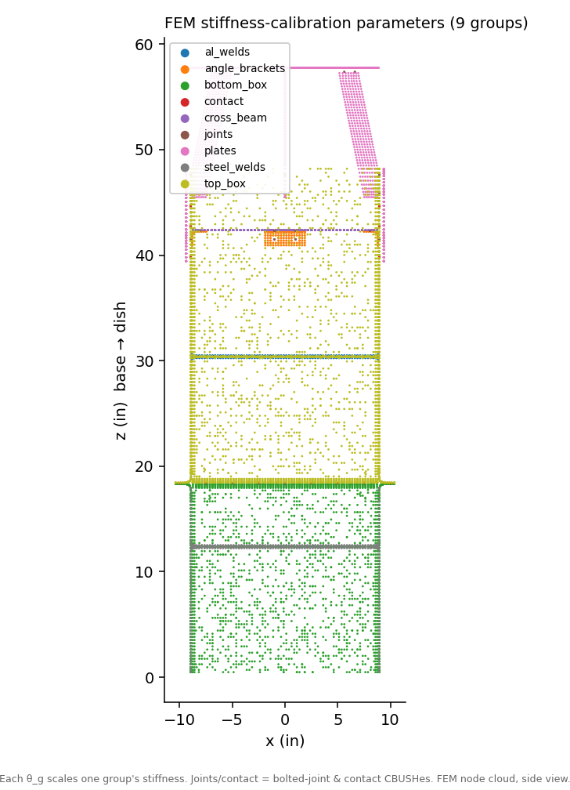
**Figure 1.** The ShockSat finite-element model (node cloud, side view, base at bottom to antenna dish at top), colored by the nine stiffness-calibration parameter groups. Each group's stiffness is scaled by one uncertain parameter θ. *(Source workspace: shocksat_modelclass_L5_20260619.)*

**Data.** Two independent data sources exist. (i) A 33-mode experimental modal survey (76 instrumented locations, up to 3 measurement axes each) provides measured natural frequencies and mode shapes; this is the **calibration** observable for every method compared here. (ii) Five impact-hammer test configurations — different excitation points and directions — provide averaged FRFs at ~110 accelerometer channels each over 45–260 Hz. These five drive datasets are **never used for calibration**; they are the held-out answer keys. No unit-to-unit or test-to-test variability data exist; that uncertainty axis is documented as absent rather than silently modeled.

**The empirical wall that motivates the QOI choice.** Point-by-point FRF amplitude prediction at individual sensors is bounded by mode-*shape* fidelity (Figure 2): the correlation between predicted and measured log-amplitude is ~0.27 with no data assistance, ~0.44 when 90% of sensors calibrate an amplitude scale and 10% are predicted, and ~0.70 even when the *measured* shapes are used directly (an oracle bound). Parameter updating, ~50 mesh and model-form edits (plateau ~0.38), and richer parameterizations do not close this gap. We therefore deliver at the QOI level: the **net interface force at the top tray's center of gravity (CG)** — the total force a mounted payload would experience — following the force-limited-vibration convention of NASA Handbook 7004C (NASA, 2012). Its in-plane ("shear," X and Y) components are driven by *measured* global modes (114–197 Hz); its out-of-plane ("normal," Z) component is driven by *unmeasured* plate modes (234–258 Hz) above the survey's instrumentation ceiling — so the two components have fundamentally different trust and are never blended (Figure 3).

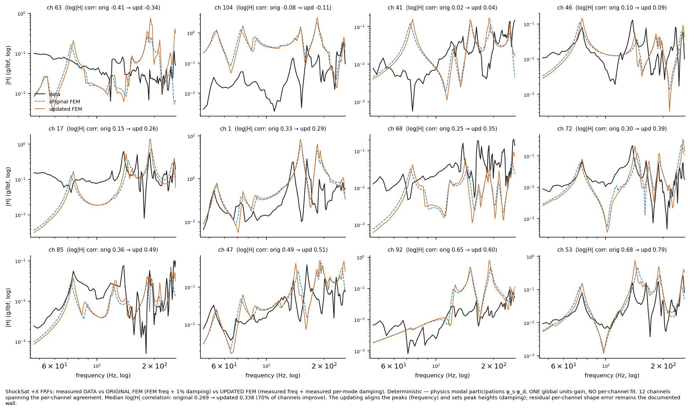
**Figure 2.** The wall: measured FRF amplitude (black) versus the original model (blue dashed) and the parameter-updated model (orange) at 12 representative accelerometer channels (log–log axes). Updating aligns the resonance peaks (frequencies) but the channel-by-channel amplitude pattern — set by mode shapes — remains wrong; median log-amplitude correlation improves only 0.27→0.34. *(Source: shocksat_psd_envelope_twin_20260623.)*

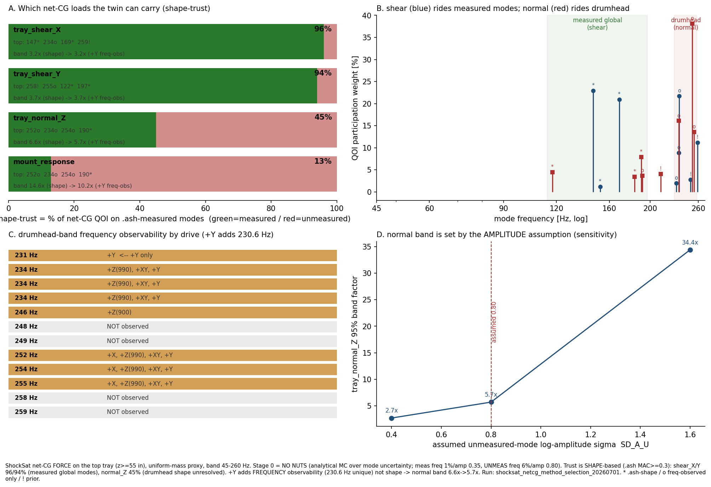
**Figure 3.** Trust is quantity-dependent. Share of each net-force component carried by *measured* (test-verified) modes: in-plane shear ~94–96%; out-of-plane normal only ~45%, because the driving plate modes were above the modal survey's frequency ceiling. Any honest method must therefore produce a *much wider* interval for the normal component. *(Source: shocksat_netcg_method_selection_20260701.)*

## 3. Methods

### 3.1 Model, priors, and three ways to use shape information

The reduced stiffness model is K(θ) = A_fix + Σ_p θ_p A_p, where each θ_p scales one parameter group's stiffness contribution and the prior (the assumed distribution before seeing data) is log θ_p ~ Normal(0, 0.25²) — i.e., parameters are believed to be within roughly ±50% of nominal. Candidate model modes are paired one-to-one with the 33 survey modes by optimal assignment on the full MAC similarity matrix (the Hungarian algorithm; Kuhn, 1955), with the pairing **frozen** before scoring — this prevents each candidate from opportunistically re-pairing modes to flatter itself, a score-inflation mechanism we had previously observed. Three levels of shape use are compared, all calibrated on the *same* paired survey observations:

- **S0 — frequencies only.** The measured squared natural frequencies are compared to the model's, with an inferred relative error scale (a standard modal eigenvalue likelihood; Vanik et al., 2000; Yuen, 2010; see the review by Kiran et al., 2025, Eq. 25).
- **S1 — frequencies + MAC.** Adds a penalty on shape mismatch, (1 − MAC)²/σ_mac², at the survey's measured locations, with σ_mac inferred. Because gradients of eigenvectors blow up when two modes have nearly identical frequencies (the rate of change grows as one over the frequency gap; Fox & Kapoor, 1968), the shape term uses a first-order perturbation around the nominal model with the near-degenerate denominators damped (Tikhonov-style regularization, floor = half the median modal gap) — a documented smoothing that keeps a genuine parameter gradient from well-separated modes while bounding the unstable ones.
- **S2 — inferred shape field.** Following the mode-matching-free Bayesian modal-updating idea of Beck and co-workers (Yuen, Beck & Katafygiotis, 2006), the mode shapes themselves become unknowns: φ = φ_model + 0.3·(free perturbation), pulled toward consistency with K(θ) (via the Rayleigh quotient, which avoids differentiating an eigen-decomposition entirely) and toward the measured survey shapes.

All posteriors are sampled with the No-U-Turn Sampler (NUTS — an adaptive Hamiltonian Monte Carlo method; Hoffman & Gelman, 2014) in NumPyro (Phan et al., 2019), 4 chains, 64-bit precision. A run is accepted only if, over *all* sampled variables: the between-chain agreement statistic R-hat ≤ 1.05, the effective sample size (ESS, the equivalent number of independent posterior draws) ≥ 200, and fewer than 2% divergent transitions (Vehtari et al., 2021). Every posterior reported in this paper passed (worst R-hat 1.0011).

### 3.2 Predicting the force with an explicit model-error term

The predicted force spectrum at each excitation is a sum over modes of (tray participation) × (drive-point participation) × (resonant amplification), with 1% modal damping. Two uncertainty layers wrap it. First, per-mode tiers: modes verified by the survey get tight frequency/amplitude uncertainty (1% / 0.35 log-units); unmeasured modes get wide (6% / 0.80). Second — the key ingredient — a **statFEM-style output-error field, denoted F(k)**: a multiplicative correction to the predicted spectrum, correlated over one octave in frequency, whose magnitude automatically grows (0.25 → 0.80 log-units) exactly where unmeasured modes dominate the response. This is the statistical finite element method's central move — acknowledge model error explicitly in the observation equation rather than forcing parameters to absorb it (Girolami et al., 2021; Febrianto et al., 2022) — specialized here to spectral QOIs with a QOI-aware variance; a frequency- and spatially-correlated observation-error model in structural dynamics has also been developed by Schneider et al. (2022). Independently *learning* the output error from cross-drive residuals (with NUTS) gives a magnitude of ≈0.94 log-units but a correlation length of only ≈0.10 octave: the model error is large but nearly point-wise in frequency, so it averages out under octave-band smoothing. This is why intervals are delivered and validated at one-octave resolution, and point-wise FRFs are not.

### 3.3 The validation harness

1. **Pre-registration + locked checker.** Questions, candidates, thresholds, and baseline bars are written first; the automated checking script is hash-locked before any science runs and never edited during a trial. Outcomes are three-tier — met / documented honest miss / blocking — and a blocking outcome distinguishes "pre-registered claim falsified" (a reportable scientific finding) from "pipeline failure" (a defect to fix). This borrows the pre-registration discipline of the replication-crisis reforms (Nosek et al., 2018).
2. **Coverage hard gate.** The 95% interval must contain the held-out reference (energy-weighted so misses at resonance peaks dominate, one-octave smoothed; narrow exceedances tolerated up to ~0.5–1 decibel (dB), where 6 dB is a factor of ~2 in amplitude). Two references are used: a plausible-truth ensemble, and — decisively — **leave-one-drive-out folds**: for each of the five excitation configurations, that configuration's net force is reconstructed from *its own measured FRFs* and the method's interval (calibrated with no access to any drive data) must contain it. The reconstruction is identical for every candidate method, so it cannot favor any of them.
3. **Hide-known-modes audit (overconfidence audit).** Deliberately remove the top three measured, QOI-driving modes from what the method is allowed to treat as known, and from the truth reference. An honest method's interval must *widen* (ratio > 1) because real information was taken away. A method whose interval does not respond is narrow through blindness, not knowledge, and is disqualified regardless of how attractive its intervals look.
4. **Selection = coverage first, then narrowness**, with every "best" reported as best-of-N.
5. **Structural score protections.** Two previously observed score-inflation mechanisms are forbidden by construction: fitting per-mode amplitudes inside any selection score (once produced a spurious +0.083 correlation "improvement"; only one global scale factor per held-out fold is permitted), and per-candidate re-pairing of modes (spurious +0.010; pairing is frozen, Section 3.1).

## 4. Study designs

**Study 1 — which formulation delivers the force interval?** Eighteen configurations: five uncertainty representations (parameters-only; per-mode tiers; feature-space; the statFEM-style F(k); hierarchical pooling) across the three force components, plus the industry incumbent — the deterministic model prediction with a ±6 dB envelope, which is common aerospace practice.

**Study 2 — is a proposed test worth its cost?** Study 1's normal-force interval is wide because the driving plate modes were never measured. A standard instrument-placement analysis, computed at the single best-fit parameter value, promised that 12 well-placed plate accelerometers would narrow the interval from 5.4× to 3.5× (in units of the incumbent envelope's width; Figure 4b). Before recommending hardware, we *rehearsed* the entire campaign synthetically: simulate the proposed test's data from a plausible truth, run the actual inference pipeline (36 NUTS posteriors), deliver the actual interval, and compare to the promise. Six pass/fail criteria were pre-registered; falsification was an accepted outcome.

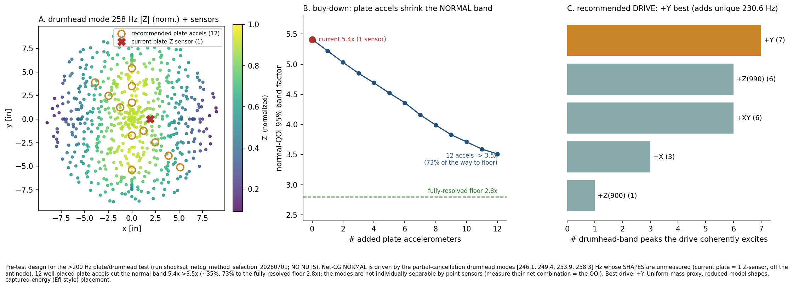
**Figure 4b.** The instrument-placement analysis under rehearsal in Study 2: the modes driving the normal force (a cluster of plate modes near 246–258 Hz), the proposed sensor placements, and the promised interval reduction versus sensor count — computed, crucially, at a single best-fit parameter value. *(Source: shocksat_netcg_method_selection_20260701, pre-test design.)*

**Study 3 — can any of three celebrated levers beat the delivered baseline on held-out data?** A pre-registered 2×3 matrix: MODEL {M0 = inherited FEM; M1 = best agent-generated re-modeling candidate} × SHAPE-USE {S0, S1, S2 of Section 3.1}, with F(k) always on. The M1 track is an *agentic* search: a large-language-model agent generated 151 candidate model-form changes within allowed families (joint compliance including new connections, connectivity, weld/contact representation, per-region stiffness fields, mass distribution — outright geometry rebuilding was excluded by a prior negative result), seeded by a data-driven error diagnosis plus a random exploration set. Candidates were screened by a fast reduced-basis method (verified exact at the nominal model), the top 29 solved with full 399,000-DOF eigensolutions, and the top 10 ranked by Bayesian model-class selection — the posterior probability of each model class given the calibration data, which automatically penalizes complexity (Beck & Yuen, 2004; Kiran et al., 2025, Eqs. 43–44; computed here with shape information included in the observable, and swept over prior widths). A pre-registered delivery rule: an M1 winner is delivered only if it beats M0 on *both* the selection score *and* held-out prediction.

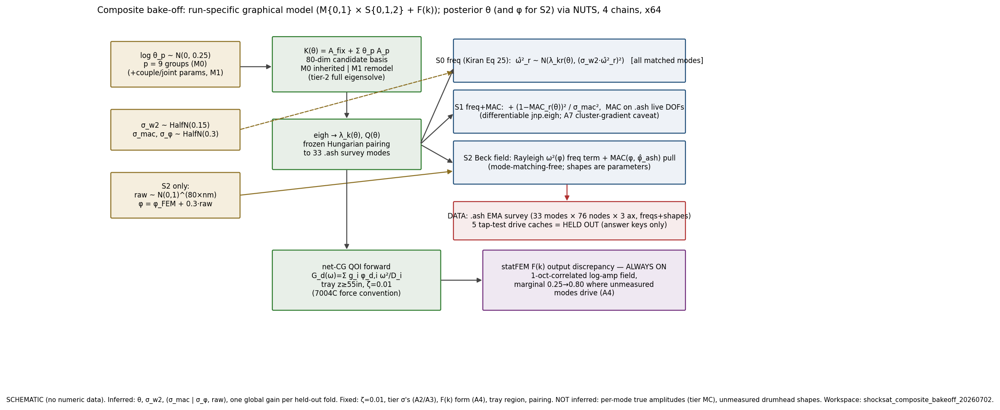
**Figure 4.** Run-specific model/likelihood diagram for Study 3: the parameter priors (left), the candidate stiffness model and frozen mode pairing (center), the three shape-use likelihood variants S0/S1/S2 (right), the calibration data (survey) versus held-out data (five drives), and the always-on statFEM-style output-error term F(k) feeding the force prediction. *(Source: shocksat_composite_bakeoff_20260702.)*

## 5. Results

### 5.1 Study 1: the winner, the false sharpener, and the incumbent

**Winner.** The statFEM-style F(k) formulation delivers the narrowest intervals that pass both gates: shear 1.51× (X) and 2.30× (Y) the incumbent envelope's width with held-out containment 0.995/0.982, and normal 2.53× with 0.987 (Figure 5). At the five held-out excitation configurations, the shear-X interval contains the measured reconstruction in 5 of 5; shear-Y in 4 of 5, with the single gap diagnosed as a drive-specific outlier (one 73 Hz mode excited five-fold more strongly at one end-drive), not a systematic model error.

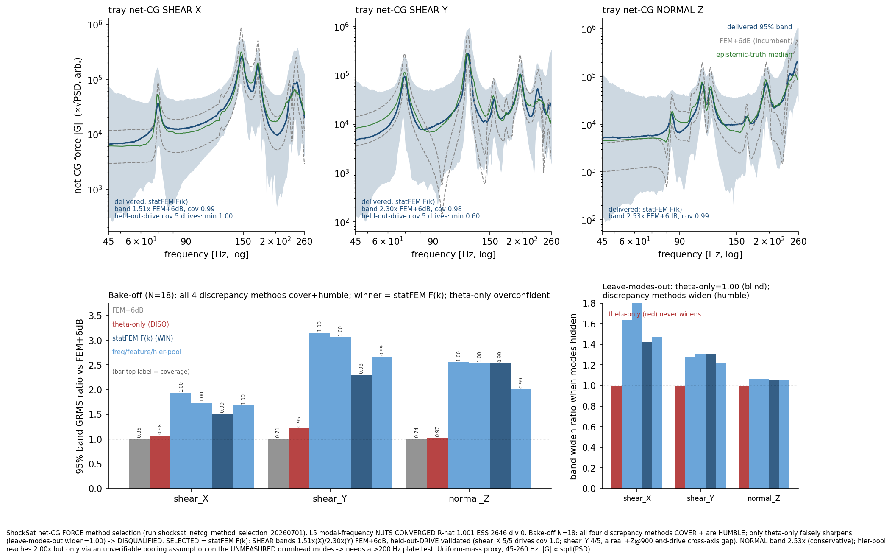
**Figure 5.** Study 1 delivery: 95% net-force intervals (per component) for the winning formulation versus the industry "model + 6 dB" envelope, one-octave smoothed. The normal component's wide interval is honest: its driving modes were never measured. *(Source: shocksat_netcg_method_selection_20260701; checker status green 22/0/0.)*

**The false sharpener, caught.** The parameters-only formulation (posterior over stiffness parameters, no model-error term) is the narrowest of all candidates and shows high nominal containment. The hide-known-modes audit exposes it: remove the top measured modes and its interval widens by a factor of exactly 1.00 — it carries no representation of amplitude or shape ignorance, so its width cannot respond to information at all. It is disqualified as a method. Every formulation carrying an explicit model-error term widens correctly (1.42–1.82).

**The incumbent fails its own implicit claim.** The "model + 6 dB" envelope's held-out containment is 0.87 (shear X), 0.71 (shear Y), and 0.74 (normal) — the standard practice is simultaneously arbitrary and, on this structure, not conservative enough exactly where the data can check it.

**Honest-width audit.** Learning the output error from data (Section 3.2) confirms the delivered intervals are defensible at octave resolution and *only* at that resolution (Figure 6).

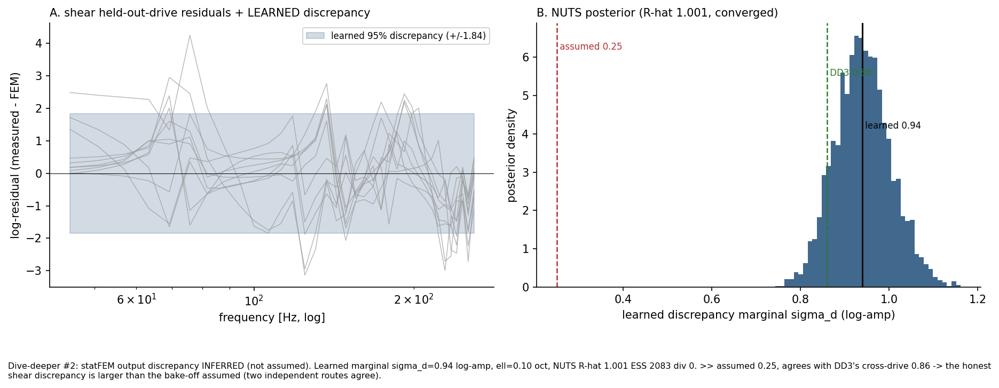
**Figure 6.** Learned versus assumed model error. Cross-drive residuals imply a large (~0.94 log-unit) but nearly point-wise-in-frequency (correlation length ~0.10 octave) output error; two independent estimation routes agree. Under one-octave smoothing it largely averages out — the delivered intervals survive; point-wise predictions would not. *(Source: shocksat_netcg_method_selection_20260701, NUTS R-hat 1.001.)*

### 5.2 Study 2: the rehearsal falsifies the instrument-placement promise

The rehearsed campaign returns interval ratios of 6.17× (1 sensor), 6.20× (12 sensors), and 6.20× (20 sensors) — **no reduction at all**, against the promised 3.5× (Figure 7). The pre-registered checker returned exactly the intended verdict: claim falsified, pipeline sound (containment 0.998; 35 of 36 posteriors converged).

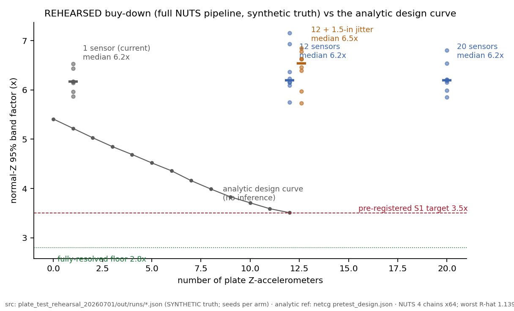
**Figure 7.** Promised versus rehearsed. The placement analysis computed at the single best-fit parameter value (curve) promised 5.4×→3.5×; the full rehearsal carrying the parameter posterior (points) delivers ~6.2× regardless of sensor count. *(Source: plate_test_rehearsal_20260701; checker 28 green / 3 documented / 1 falsified-claim.)*

The mechanism is instructive. The plate modes in question cluster within a few hertz of each other (246–258 Hz). When natural frequencies nearly coincide, mode shapes become exquisitely sensitive to parameters — a ±4% parameter posterior *rotates* the cluster's shapes, re-scattering each mode's contribution to the net force. An ablation isolates it: freezing parameters at the best fit gives the promised floor (3.05×); adding parameter uncertainty alone degrades it to 4.93×; heavy tails from sign-flipping contributions bring it to ~5.5×; even a hypothetical perfect measurement of the four dominant modes leaves ~5.1×. The constructive recovery: measuring *all twelve* modes of the cluster (not just the four net-force drivers) recovers 2.81× — a corrected test scope — and the as-designed test still buys a genuinely checkable quantity (the amplitude posterior tightens from 0.80 to 0.58 log-units with its mean within 0.08 of truth; Figure 8). Robustness: with a truth twice as dispersed, the pipeline widens to ~104× but still contains the truth — it degrades by widening, never by lying.

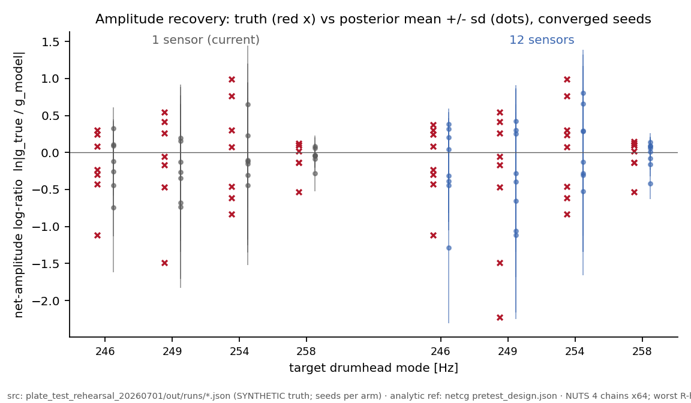
**Figure 8.** What the proposed test *does* buy: the rehearsed posterior for the plate-mode amplitudes tightens (standard deviation 0.80→0.58 log-units) with negligible bias — enough to check the key modeling assumption, not enough to deliver the promised interval reduction. *(Source: plate_test_rehearsal_20260701.)*

*The general lesson: near clustered modes, evaluate instrumentation investments against the parameter posterior, not a point estimate. Point-estimate design curves systematically overpromise.*

### 5.3 Study 3: selection scores are not validation; shape inference cuts both ways

All six matrix configurations converged (worst R-hat 1.0011, zero divergences). Table 1 and Figure 10 summarize the held-out scores.

**Table 1.** Study 3 held-out results. "Point score" is the continuous ranked probability score skill (CRPS — a proper accuracy score for probabilistic predictions; Gneiting & Raftery, 2007) versus a no-model reference, at held-out sensors (higher is better; 0 = no better than guessing the typical measured value). "Interval width" is relative to the incumbent envelope (lower = narrower). "Contains?" is the 0.95 coverage hard gate on the net-force intervals.

| configuration | point score / spread | width (shear X / Y / normal) | contains? | widens when blinded? |
|---|---|---|---|---|
| M0S0 inherited, frequencies only (baseline) | −0.78 / 1.08 | 1.84 / 1.98 / 2.54 | yes | yes (marginal on normal: 1.01, still containing 0.993) |
| M0S1 + MAC term | −0.77 / 1.08 | 1.72 / 2.06 / 2.34 | yes | yes |
| M0S2 inferred shape field | **−0.34 / 0.89** | 1.78 / 2.25 / 1.82 | **no** (0.70/0.57/0.32) | yes |
| M1S0 re-modeled, frequencies only | −0.75 / 1.10 | 1.94 / 1.66 / 2.42 | yes | yes |
| M1S1 re-modeled + MAC | −0.71 / 1.08 | 1.71 / 1.51 / 2.50 | yes | yes |
| M1S2 re-modeled + shape field | **−0.37 / 0.91** | 1.60 / 2.18 / 1.57 | **no** | yes |

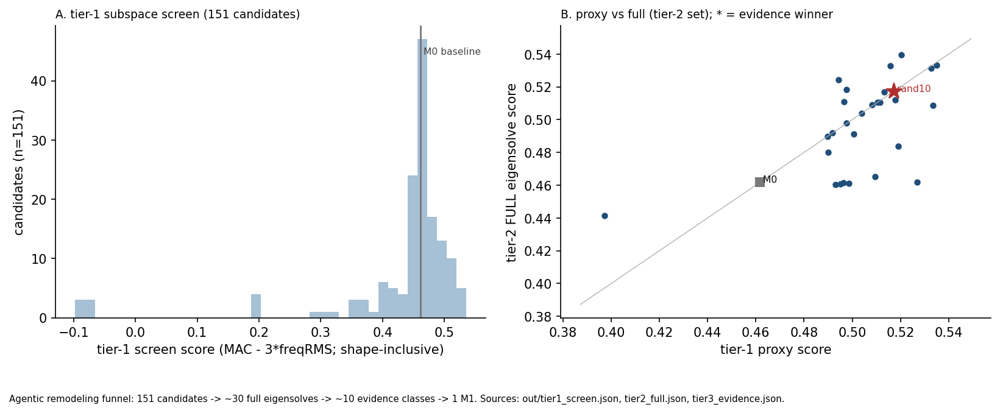
**Figure 9.** The agent-driven model-form search: 151 candidates screened by a fast reduced-basis proxy (left; the inherited model marked), with the top 29 re-solved by full eigensolutions (right; proxy vs full score, selection winner starred). *(Source: shocksat_composite_bakeoff_20260702.)*

**Selection is not validation.** The search's winner beat the inherited model *decisively* on Bayesian model-class selection: +54 log-evidence units, posterior model probability 0.72, top-ranked at every prior width tested — with mode-shape information included in the selection observable (Figure 10, left). It then improved held-out prediction by *nothing* (point score −0.75 vs −0.78; intervals no narrower). With this much irreducible model error, the marginal likelihood — its complexity penalty and shape-awareness notwithstanding — rewards whichever candidate best absorbs the calibration residuals into its own (wrong) structure. The pre-registered rule fired: reported, not delivered. Notably, a frequency-only selection score would have crowned the *same* candidate — adding shape information to the selection observable did not repair it.

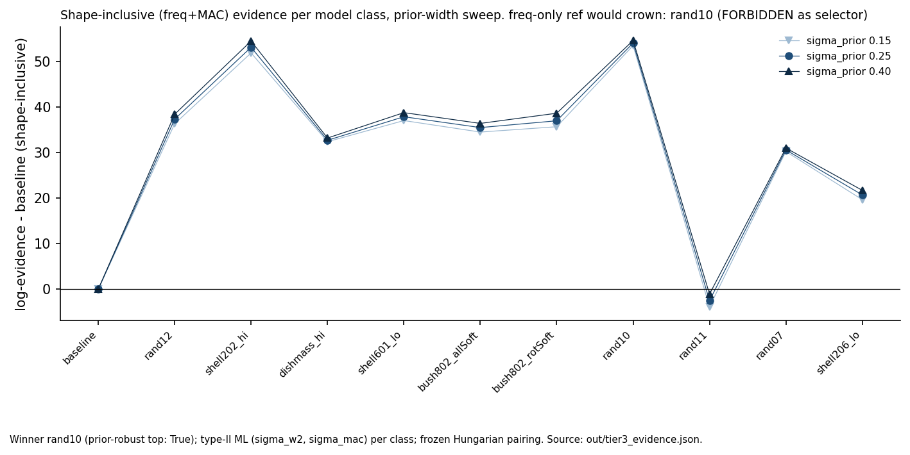
**Figure 10.** Model-class selection scores (relative to the inherited model) for the top candidates across three prior widths. The winner's margin is decisive and prior-robust — and it adds zero held-out skill. *(Source: shocksat_composite_bakeoff_20260702, tier-3 evidence.)*

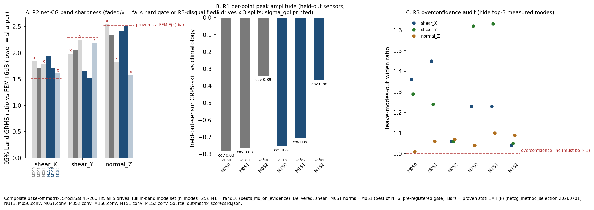
**Figure 11.** The full Study-3 matrix. (A) Net-force interval widths versus the Study-1 delivered bars; × marks configurations failing a gate. (B) Held-out point-prediction skill — the shape-field configurations (S2) are the clear point-level winners. (C) The overconfidence audit — all configurations widen when blinded. *(Source: shocksat_composite_bakeoff_20260702, checker yellow 57/6/0.)*

**Adding a MAC penalty to the likelihood changes nothing** (S1 ≈ S0 on every held-out metric) — our third replication of this null result, now on multi-reference data at the QOI level.

**Shape inference cuts both ways.** The inferred-shape configurations halve the point-prediction deficit (−0.78 → −0.34/−0.37) and shrink the point-level spread (1.08 → 0.89 log-units) — the only intervention in this entire program that moved the wall of Figure 2. But their confidently corrected shapes **fail the containment gate for the net-force intervals** (0.23–0.70 versus 0.95 required). An anti-circularity check sharpens the interpretation (Figure 12): at the held-out drives — whose answer keys are built from measured data, independent of any candidate — the shape-field configuration contains shear-X *perfectly* (5/5 at 1.00, the best of all six), so part of its apparent failure is an artifact of a truth reference built from the very model shapes it corrects. For the normal component, however, no measured answer key exists (the driving plate modes were never measured), and the shape field's confident interval there is unvalidatable and non-containing. *The extracted rule: use inferred-shape formulations where sensors can validate them; quarantine their confidence from quantities the data cannot check.*

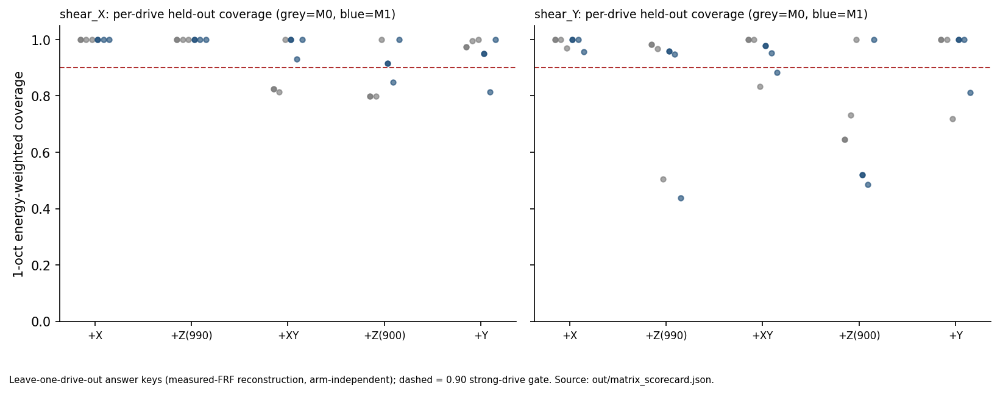
**Figure 12.** Per-drive held-out containment (five folds, shear components) for all six configurations. The inferred-shape configurations (blue, S2) contain shear-X at every drive — evidence their point-level gains are real — while the model-based truth ensemble of Figure 11A penalizes them; the normal component has no such data-based key, which is exactly where their confidence cannot be trusted. *(Source: shocksat_composite_bakeoff_20260702.)*

**Delivered twin.** The inherited model + frequency(-and-MAC) calibration + the statFEM-style F(k) output error, for both force components — Study 1's delivery reaffirmed through a six-way gauntlet. (The nominal preference for the MAC variant rests on a marginal audit threshold — widening 1.01 versus a 1.03 pass line while still containing 0.993 — and is flagged as an artifact, not claimed as a MAC win.)

## 6. Discussion

**For practitioners.** (i) Coverage-first selection with a widening audit is cheap and catches the two failure modes that matter most: intervals narrow through blindness, and confident corrections in unvalidatable directions. (ii) Deliver at the resolution the error structure supports — here, octave-band intervals are defensible because the learned model error is large but frequency-local; point-wise predictions are not. (iii) Treat Bayesian model-class selection as a ranking heuristic and gate it with held-out prediction. (iv) Rehearse instrumentation investments against the posterior; point-estimate design curves overpromise near clustered modes. (v) Measure the incumbent: the "+6 dB" envelope failed its own implicit containment claim on real held-out data — that measurement is itself a useful deliverable to an engineering organization.

**Relation to the statistical finite element method.** The winning formulation is an output-space, frequency-correlated multiplicative error model — statFEM's central idea (Girolami et al., 2021; Febrianto et al., 2022) specialized to spectral engineering QOIs with a variance that grows where unmeasured physics dominates. Companion experiments (reported in the project archive) probe the same data with a physics-informed information-field-theory formulation (Alberts & Bilionis, 2023): with an unbounded model-error variance on a whole-FRF observable the posterior diverges, while a bounded learned-temperature formulation converges and contains — suggesting that what matters under severe model error is the boundedness/structure of the error model, not the philosophical placement of the physics.

**Limitations.** One structure and one test campaign; modal damping fixed at 1%; the per-mode tier magnitudes are assumed (with sensitivity swept: the unmeasured-mode amplitude assumption drives the normal interval across 2.6×–34×); the plausible-truth ensembles for the normal component are model-based because no >200 Hz shape data exist — precisely the gap the (rehearsal-corrected) plate test would close; the model-form search covered five families but excluded geometry rebuilding; unit-to-unit variability is absent from data and model alike.

## 7. Conclusion

On a real, professionally correlated aerospace structure, the honest answer to "can Bayesian model updating deliver?" is: **yes at the quantity-of-interest level — force intervals 1.5–2.5× a (non-containing) industry envelope, validated by containment at five held-out excitation configurations — and no at the sensor-by-sensor level, and not via the levers the literature most often celebrates.** Bayesian model-class selection, shape-similarity penalties, agent-generated model-form candidates, and point-estimate test-design curves each failed a pre-registered held-out test that was designed to let them win. The methodological core — pre-registration, hash-locked checkers, coverage-first selection, and an overconfidence audit — transfers to any digital-twin claim, and the falsifications reported here are, we believe, at least as useful to the field as the delivery.

## Data & Code Availability
All studies are archived as replayable workspaces (one-command replay; hash-locked checkers; per-decision logs): the method-selection study (checker: 22 criteria met / 0 documented misses / 0 blocking), the test rehearsal (28/3/1, the blocking item being the pre-registered falsification), and the composite study (57/6/0). [Repository/DOI to be arranged; NASA data permissions to be confirmed.]

## Acknowledgments
[Advisor discussions: I. Bilionis (validation-under-model-error framing). D. Gibert (TBD). NASA ShockSat dataset provenance/permissions TBD.]

## References
*Bibliographic details confirmed against publisher records (browser verification pass, 2026-07-02). One item — Vanik et al. (2000), added for the eigenvalue-likelihood lineage — should be spot-checked before submission.*

- Alberts, A., & Bilionis, I. (2023). Physics-informed information field theory for modeling physical systems with uncertainty quantification. *Journal of Computational Physics*, 486, 112100. https://doi.org/10.1016/j.jcp.2023.112100
- Allemang, R. J. (2003). The modal assurance criterion — twenty years of use and abuse. *Sound and Vibration*, 37(8), 14–23.
- Beck, J. L., & Katafygiotis, L. S. (1998). Updating models and their uncertainties. I: Bayesian statistical framework. *Journal of Engineering Mechanics*, 124(4), 455–461. https://doi.org/10.1061/(ASCE)0733-9399(1998)124:4(455)
- Beck, J. L., & Yuen, K.-V. (2004). Model selection using response measurements: Bayesian probabilistic approach. *Journal of Engineering Mechanics*, 130(2), 192–203. https://doi.org/10.1061/(ASCE)0733-9399(2004)130:2(192)
- Brynjarsdóttir, J., & O'Hagan, A. (2014). Learning about physical parameters: the importance of model discrepancy. *Inverse Problems*, 30(11), 114007. https://doi.org/10.1088/0266-5611/30/11/114007
- Febrianto, E., Butler, L., Girolami, M., & Cirak, F. (2022). Digital twinning of self-sensing structures using the statistical finite element method. *Data-Centric Engineering*, 3, e31. https://doi.org/10.1017/dce.2022.28
- Fox, R. L., & Kapoor, M. P. (1968). Rates of change of eigenvalues and eigenvectors. *AIAA Journal*, 6(12), 2426–2429. https://doi.org/10.2514/3.5008
- Friswell, M. I., & Mottershead, J. E. (1995). *Finite Element Model Updating in Structural Dynamics*. Kluwer Academic Publishers, Dordrecht. https://doi.org/10.1007/978-94-015-8508-8
- Girolami, M., Febrianto, E., Yin, G., & Cirak, F. (2021). The statistical finite element method (statFEM) for coherent synthesis of observation data and model predictions. *Computer Methods in Applied Mechanics and Engineering*, 375, 113533. https://doi.org/10.1016/j.cma.2020.113533
- Gneiting, T., & Raftery, A. E. (2007). Strictly proper scoring rules, prediction, and estimation. *Journal of the American Statistical Association*, 102(477), 359–378. https://doi.org/10.1198/016214506000001437
- Hoffman, M. D., & Gelman, A. (2014). The No-U-Turn Sampler: adaptively setting path lengths in Hamiltonian Monte Carlo. *Journal of Machine Learning Research*, 15(1), 1593–1623.
- Kennedy, M. C., & O'Hagan, A. (2001). Bayesian calibration of computer models. *Journal of the Royal Statistical Society: Series B*, 63(3), 425–464. https://doi.org/10.1111/1467-9868.00294
- Kiran, R. P., Das, A., & Bansal, S. (2025). A state-of-the-art review of Bayesian finite element model updating techniques for structural systems. *Probabilistic Engineering Mechanics*, 80, 103761. https://doi.org/10.1016/j.probengmech.2025.103761
- Kuhn, H. W. (1955). The Hungarian method for the assignment problem. *Naval Research Logistics Quarterly*, 2(1–2), 83–97. https://doi.org/10.1002/nav.3800020109
- Mottershead, J. E., Link, M., & Friswell, M. I. (2011). The sensitivity method in finite element model updating: a tutorial. *Mechanical Systems and Signal Processing*, 25(7), 2275–2296. https://doi.org/10.1016/j.ymssp.2010.10.012
- NASA (2012). *Force Limited Vibration Testing* (NASA-HDBK-7004C). National Aeronautics and Space Administration, Washington, DC.
- Nosek, B. A., Ebersole, C. R., DeHaven, A. C., & Mellor, D. T. (2018). The preregistration revolution. *Proceedings of the National Academy of Sciences*, 115(11), 2600–2606. https://doi.org/10.1073/pnas.1708274114
- Phan, D., Pradhan, N., & Jankowiak, M. (2019). Composable effects for flexible and accelerated probabilistic programming in NumPyro. *arXiv:1912.11554*.
- Schneider, F., Papaioannou, I., Straub, D., Winter, C., & Müller, G. (2022). Bayesian parameter updating in linear structural dynamics with frequency transformed data using rational surrogate models. *Mechanical Systems and Signal Processing*, 166, 108407. https://doi.org/10.1016/j.ymssp.2021.108407
- Simoen, E., De Roeck, G., & Lombaert, G. (2015). Dealing with uncertainty in model updating for damage assessment: a review. *Mechanical Systems and Signal Processing*, 56–57, 123–149. https://doi.org/10.1016/j.ymssp.2014.11.001
- Vanik, M. W., Beck, J. L., & Au, S. K. (2000). Bayesian probabilistic approach to structural health monitoring. *Journal of Engineering Mechanics*, 126(7), 738–745. [VERIFY]
- Vehtari, A., Gelman, A., Simpson, D., Carpenter, B., & Bürkner, P.-C. (2021). Rank-normalization, folding, and localization: an improved R̂ for assessing convergence of MCMC (with discussion). *Bayesian Analysis*, 16(2), 667–718. https://doi.org/10.1214/20-BA1221
- Yuen, K.-V. (2010). *Bayesian Methods for Structural Dynamics and Civil Engineering*. John Wiley & Sons (Asia), Singapore. https://doi.org/10.1002/9780470824566
- Yuen, K.-V., Beck, J. L., & Katafygiotis, L. S. (2006). Efficient model updating and health monitoring methodology using incomplete modal data without mode matching. *Structural Control and Health Monitoring*, 13(1), 91–107. https://doi.org/10.1002/stc.144
