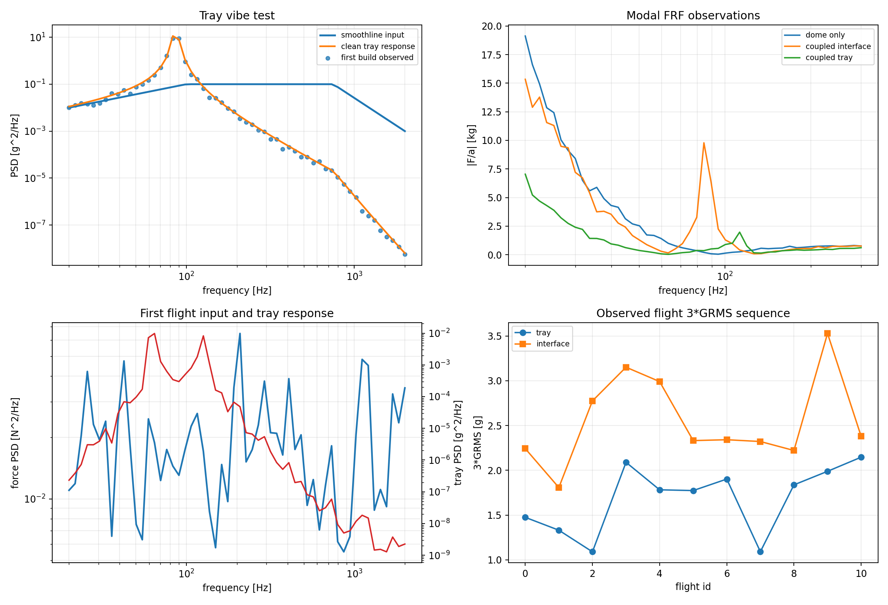
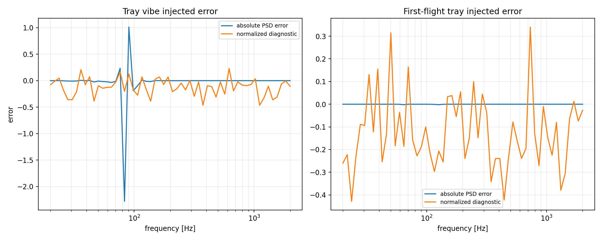
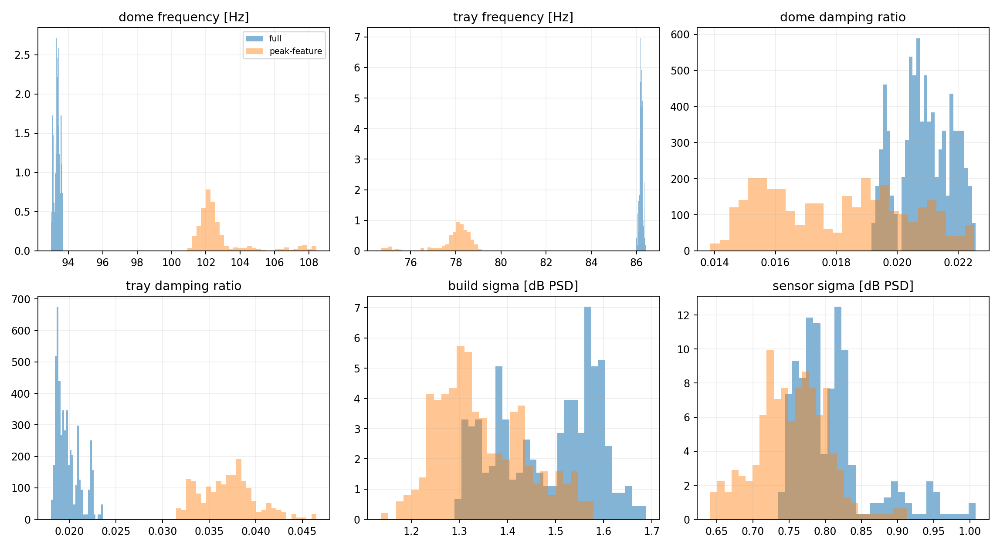
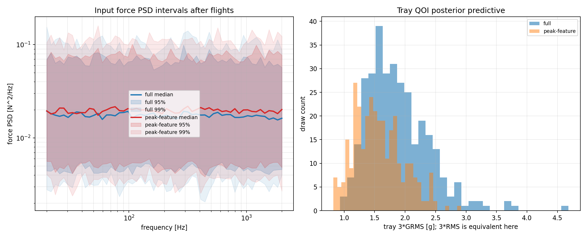
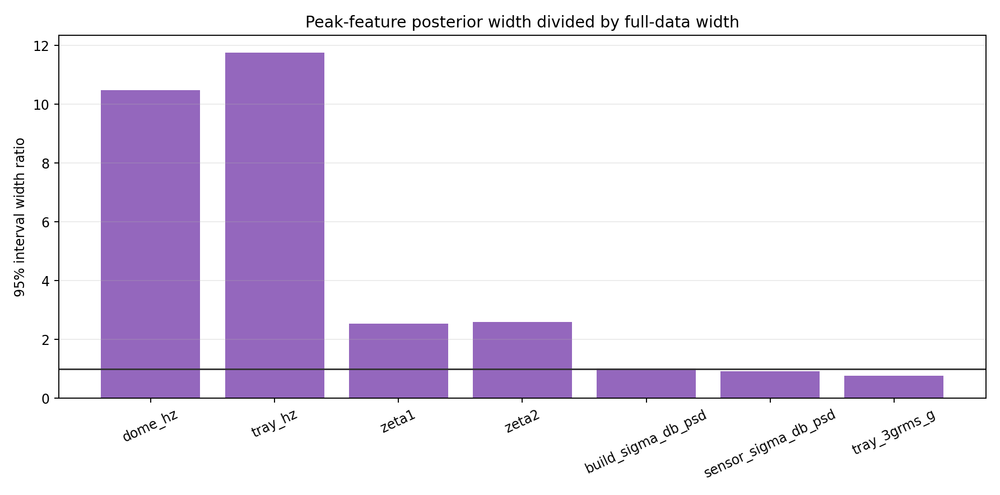
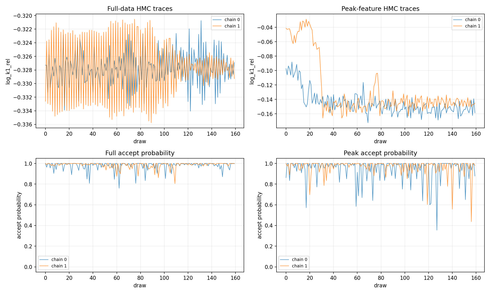
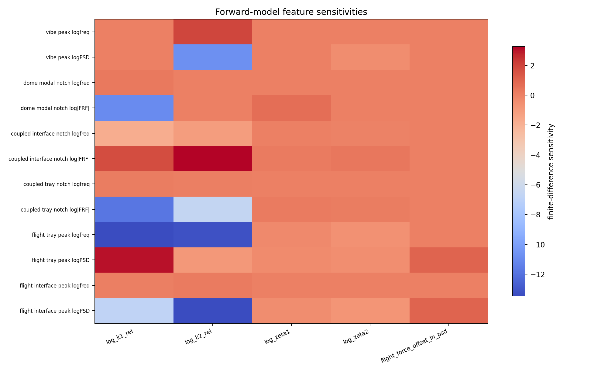
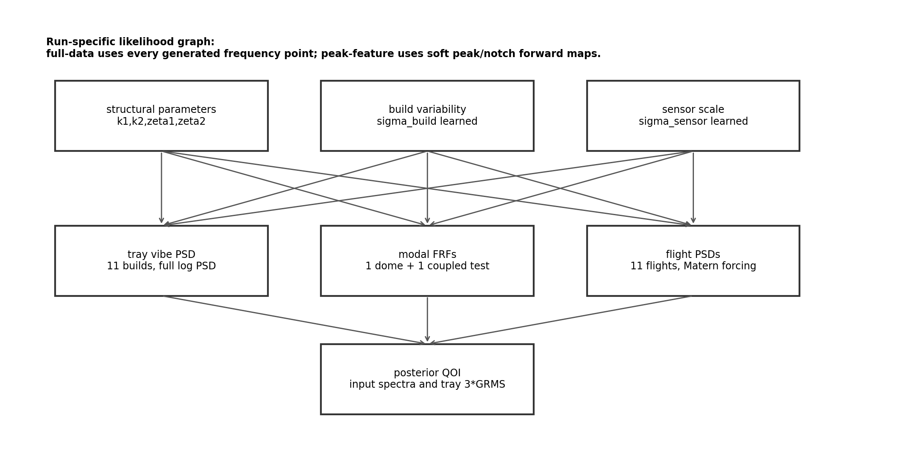

# Codex GPT-5.5 Sequential Vibe/Modal/Flight Packet

## Method Summary

Decision supported: estimate post-flight input spectra and tray acceleration QOI intervals for a dome/tray coupled structure after tray vibe, dome modal, coupled modal, first flight, and ten later build/flight observations.

Objective/success metric: posterior uncertainty in input force PSD and tray 3*GRMS/3*RMS QOI, with a comparison between full FRF/PSD likelihoods and peak-feature likelihoods.

Allowed experiment/search choices in this runner: none. The staged data sequence is fixed by the task card. Human judgment remains responsible for whether this toy 2DOF framing is an adequate aerospace decision model.

Wrong-question triggers: the real structure is not well approximated by a 2DOF dome/tray model; phase/complex FRF errors matter more than log-magnitude errors; flight forcing is not stationary in log frequency; or build/test variability is correlated in a way this marginal likelihood omits.

Model form: two masses, dome/source `m1` and tray/load `m2`, coupled by the tray stiffness/damping convention used in the fresh 2DOF packet. Full-data likelihood uses every generated log PSD and log FRF-magnitude point. Peak-feature likelihood uses observed hard peak/notch summaries compared with differentiable soft peak/notch features predicted from the same forward model.

Likelihood equation, full-data sketch: residual vectors are `r = log(y_obs) - log(y_model(theta))`; vibe/modal residual covariance includes learned build and sensor PSD-space scales; flight residual covariance additionally includes fixed known 3 dB Matern-3/2 forcing covariance in natural log frequency. Modal FRFs use log magnitude only, so phase is a documented limitation.

Data count: 11 tray vibe tests, 1 dome modal test, 1 coupled modal test with interface and tray drive-point channels, 11 flights, 56 PSD frequency points, and 48 modal FRF frequency points.

Inferred variables: dome/tray natural frequencies via `k1,k2`, dome/tray damping ratios, global flight force PSD scale, build-to-build variability scale, and sensor-noise scale. Fixed variables: masses, smoothline table, Matern-3/2 length scale, and fixed 3 dB flight-to-flight variability. Non-inferred latent variables: individual build effects, individual flight forcing paths, phase noise, and FRF complex phase discrepancy.

## Backend Handling

Python version: 3.9.6. NumPyro installed: False. JAX installed: False. PyMC installed: False. PyTorch installed: True.

Resolution: numpyro is not installed. JAX, PyMC, and ArviZ are also absent. No package installation was attempted. The run uses a labeled custom PyTorch-autograd fixed-trajectory HMC backend; NUTS is not active.

This is real gradient-based HMC, not random-walk Metropolis. It is not NUTS; tree depth is therefore marked not applicable in `nuts_diagnostics.json`.

## Quantity Contracts And Assumptions

See `quantity_contracts.md` and `assumptions_ledger.md`. Key conventions: PSD-space dB uses `factor = 10 ** (dB / 10)`, dome is `m1`, tray is `m2`, and flight-to-flight forcing variability remains fixed at 3 dB.

## Posterior Summary

| Quantity | Full mean | Full 95% | Peak mean | Peak 95% |
|---|---:|---:|---:|---:|
| Dome frequency [Hz] | 93.37 | [93.06, 93.69] | 102.8 | [101.2, 107.8] |
| Tray frequency [Hz] | 86.21 | [86.05, 86.38] | 77.9 | [75.01, 78.88] |
| Build sigma [dB PSD] | 1.484 | [1.314, 1.647] | 1.346 | [1.203, 1.543] |
| Sensor sigma [dB PSD] | 0.8101 | [0.7468, 0.9533] | 0.7542 | [0.6563, 0.8464] |
| Tray 3*GRMS [g] | 1.874 | [1.127, 3.047] | 1.563 | [0.9295, 2.418] |
| Tray 3*GRMS 99% [g] | - | [0.9749, 3.728] | - | [0.8413, 2.588] |

## Likelihood Comparison

Full-data usage: all generated tray-vibe log PSD points, modal log-FRF magnitudes, and flight tray/interface log PSD points.

Peak-feature usage: hard observed peak/notch features compared to differentiable soft peak/notch forward-model features.

Interval-width ratios, peak/full: {
  "dome_hz": 10.480554230369252,
  "tray_hz": 11.748010416594903,
  "zeta1": 2.5429352716528384,
  "zeta2": 2.590507326559092,
  "build_sigma_db_psd": 1.0201305942304035,
  "sensor_sigma_db_psd": 0.9202582399715914,
  "tray_3grms_g": 0.7755793585752248
}

The feature likelihood uses transfer-function peak/notch features predicted from the same forward model. It does not equate a peak or notch with a natural frequency; see `feature_sensitivity.json` and `figures/peak_feature_mapping_sensitivity.png`.

## Figures

## Checker Status

Self-check pass: True. Immutable checker hash command is recorded in `checks.json` and `commands.md`.

## Limitations

- NUTS was not achieved; fixed-trajectory HMC was used and labeled.
- Modal likelihood uses log magnitude, not complex real/imag phase.
- Individual build effects and individual flight forcing GP paths are not in the HMC state; they are marginalized approximately and sampled for posterior predictive QOI intervals.
- A checker pass is not proof of physical correctness.
