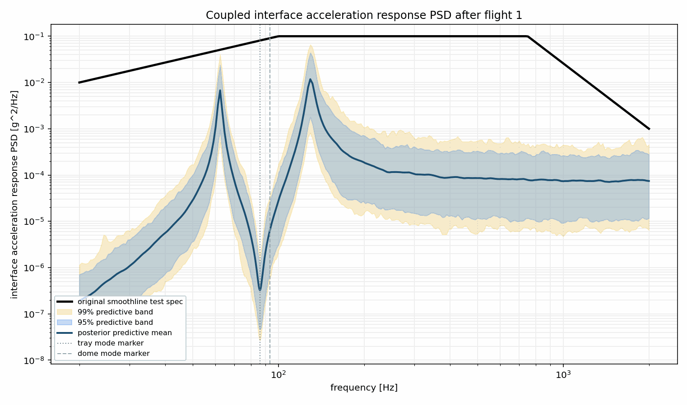
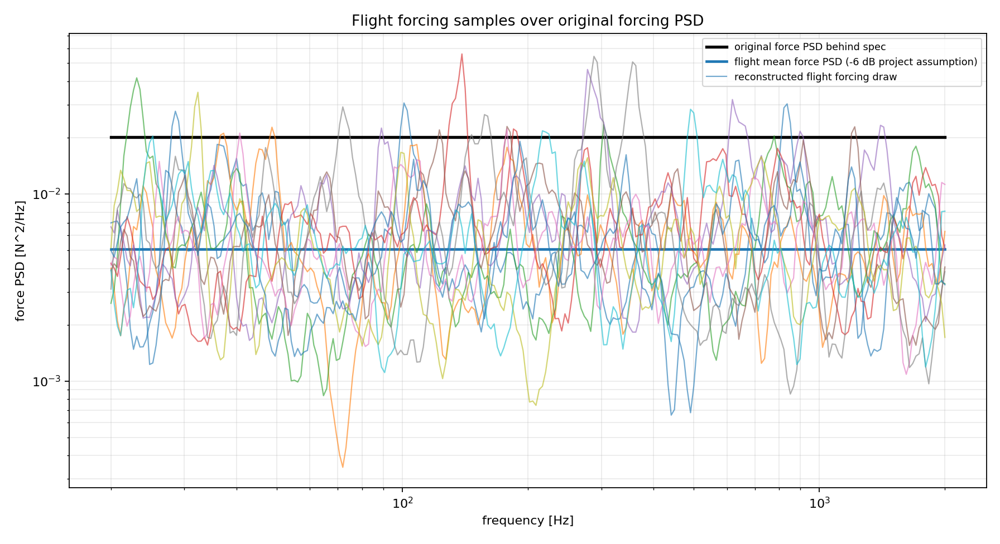
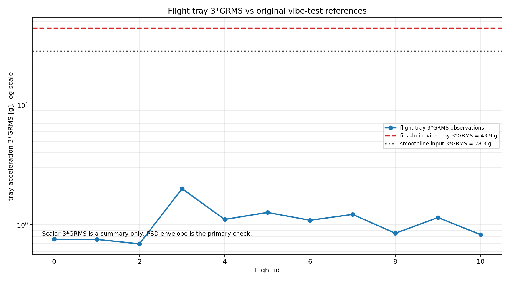
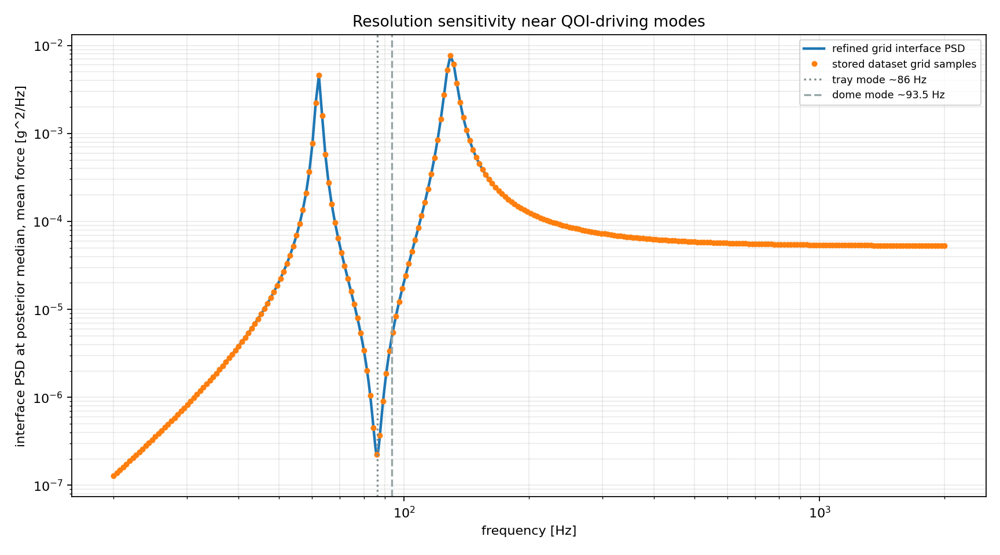

# Codex GPT-5.5 Round 2 Packet

## Method Summary

Status: **PASS** for the strict final NUTS convergence gate.

Model form: a coupled 2DOF dome/tray frequency-response model with inferred structural parameters `dome_hz`, `tray_hz`, `zeta1`, `zeta2`, learned build-to-build log-PSD scale, learned sensor log-PSD scale, non-centered raw build effects, and non-centered per-flight forcing-QOI latent scalars.

Likelihood data usage: whole stored tray vibe log PSD at 260 frequencies; whole stored modal log-magnitude curves for dome-only, coupled interface, and coupled tray channels at 180 frequencies each; scalar tray and interface flight `3*GRMS` observations for 11 flights. The setup dataset does **not** store full flight interface PSD observations, so the key PSD bands are posterior predictive response envelopes, not direct measured flight PSD posterior bands.

Likelihood sketch: `log y_vibe(f) ~ Normal(log |T_tray|^2 + log S_spec + b_tray0, sigma_sensor)`, modal log magnitudes use `0.5*b_build`, and flight `log(3*GRMS)` uses `log q_struct(theta) + 0.5*b_build + sigma_f2f_qoi*z_flight` with `z_flight ~ Normal(0,1)`.

Data count: 1 tray vibe PSD curve, 3 modal log-magnitude curves, 11 tray flight scalar QOIs, and 11 interface flight scalar QOIs. Flight-to-flight forcing variability is modeled as fixed 3 dB PSD-space variability; full frequency-dependent flight forcing curves are used for posterior predictive response bands.

## Engineering Question

Does the original smoothline test spec envelope the predicted coupled interface flight response PSD across frequency? The primary metric is frequencywise PSD envelope comparison, especially the 99% band. The tray `3*GRMS` overlay is only a scalar summary.

## NUTS Diagnostics

- Sampler attempted: NumPyro NUTS in `.venv_nuts`.
- Chains: 4; warmup per chain: 900; samples per chain: 900.
- Max rank-normalized R-hat over all sampled/deterministic variables: `1.0071` at `flight_tray_force_raw`; gate `< 1.01`.
- Min bulk ESS: `1080.1` at `sigma_build_db`; gate `>= 400`.
- Min tail ESS: `1199.8` at `sigma_build_db`; gate `>= 400`.
- Divergences: `0`; clean target `0`.

Early cumulative-frame warning: the final all-flight posterior passed, but GIF prefix fits 1-3 had divergences and should be read as hard-WARN frames, not clean final posterior claims:

- `cumulative_1`: R-hat `1.0098`, bulk ESS `551.9`, tail ESS `680.9`, divergences `4`.
- `cumulative_2`: R-hat `1.0089`, bulk ESS `600.7`, tail ESS `691.3`, divergences `4`.
- `cumulative_3`: R-hat `1.0048`, bulk ESS `673.5`, tail ESS `933.0`, divergences `1`.

## Priority Figures

## Interface PSD Envelope Summary

- Final frame 99% band exceeds spec at any frequency: `False`.
- Final frame max 99%/spec ratio: `0.5929` at `62.41 Hz`.
- Final frame frequency fraction with 99% band above spec: `0.0000`.

## Resolution Sensitivity

- Base grid count: `260`; refined grid count: `861`.
- Interface `3*GRMS` median refined-minus-base shift: `-0.0006%`.
- Interface peak PSD median refined-minus-base shift: `0.0000%`.

## Forcing Reconstruction Note

`sequential_dataset.json` did not store the full per-flight forcing PSD curves. I reconstructed the setup RNG sequence and checked it against the stored force log-mean/log-sd summaries. Maximum log-mean error was `0.000e+00` and maximum log-sd error was `0.000e+00`.

## Limitations

- The interface response PSD GIF is posterior predictive because full flight PSD observations are absent from the setup dataset.
- Per-flight forcing latents in NUTS are scalar QOI-level latent effects, not 260-dimensional sampled force GP curves; full GP curves are drawn in posterior prediction.
- If convergence status above is NOT CONVERGED, intervals should be treated as not-yet-converged evidence, not a clean NUTS pass.
