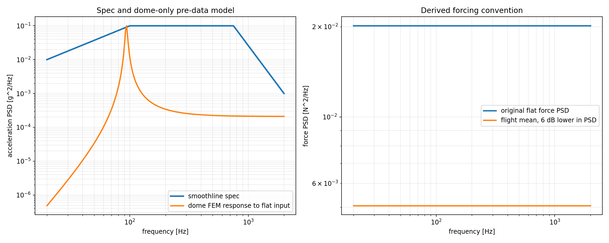
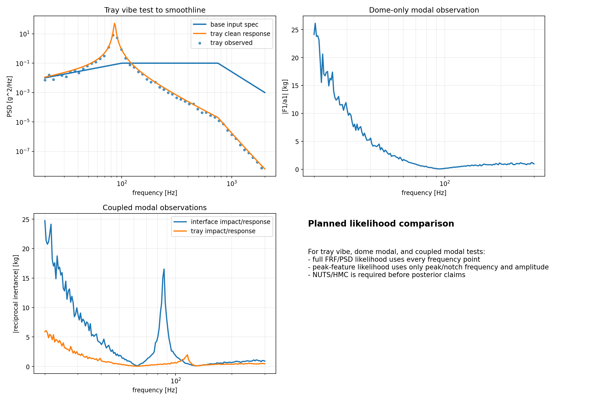
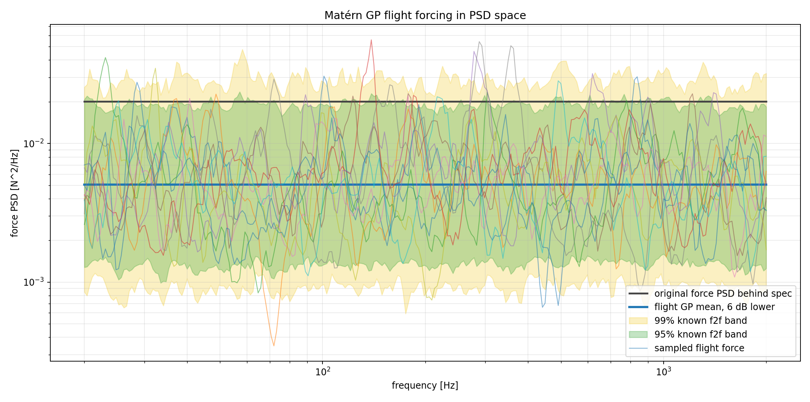
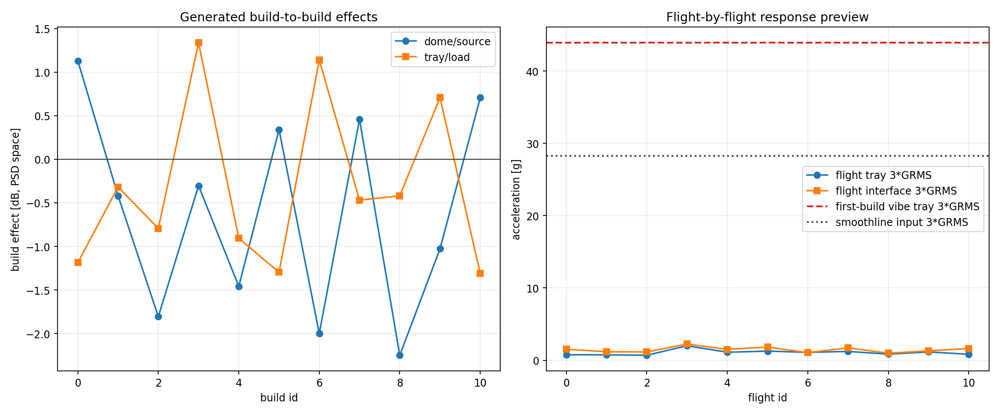
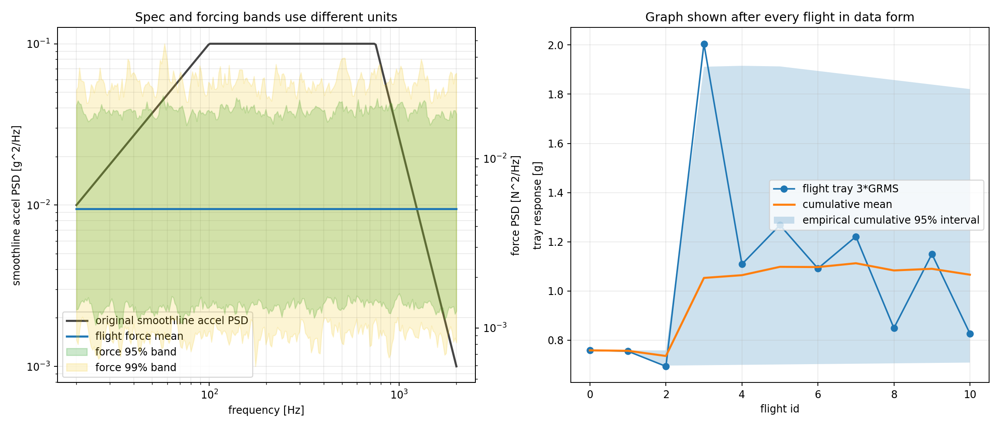

# Sequential Vibe/Modal/Flight Setup Packet

## Status

This packet sets up the research problem and generates preview data/plots. It does not perform posterior inference.

## Key Assumptions

- dB values are PSD-space dB.
- Tank/dome/source is `m1`; tray/load/secondary structure is `m2`.
- Flight-to-flight forcing variability is fixed and known at 3 dB.
- Build-to-build variability and sensor noise are generated here and should be learned in the later NUTS/HMC model.
- Flight forcing uses a Matérn-3/2 GP in log PSD with tight log-frequency length scale `0.08`.
- Mean flight forcing PSD is 6 dB below the original force PSD used by the pre-data dynamics model.

See `assumptions_ledger.md`, `quantity_contracts.md`, `db_conventions.md`, and `sources.md` before implementing inference.

## Smoothline PSD

The smoothline is log-log interpolated through:

| Frequency [Hz] | PSD [g^2/Hz] |
|---:|---:|
| 20 | 0.01 |
| 100 | 0.1 |
| 750 | 0.1 |
| 2000 | 0.001 |

## Generated Values

- Dome FEM peak response PSD: `0.1` g^2/Hz.
- First-build tray vibe observed `3*GRMS`: `43.909` g.
- Smoothline input `3*GRMS`: `28.269` g.
- Flight prior-predictive tray `3*GRMS` 95% interval: `[0.65128, 1.4598]` g.
- Flight prior-predictive tray `3*GRMS` 99% interval: `[0.61297, 1.6698]` g.

## Figures

## Next Implementation Step

Implement the NumPyro NUTS model for the staged observations. The checker must fail if NUTS diagnostics are missing or if the report implies NUTS is active before the sampler exists.
