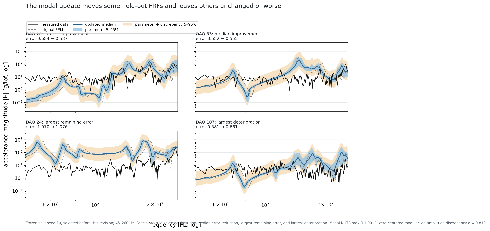
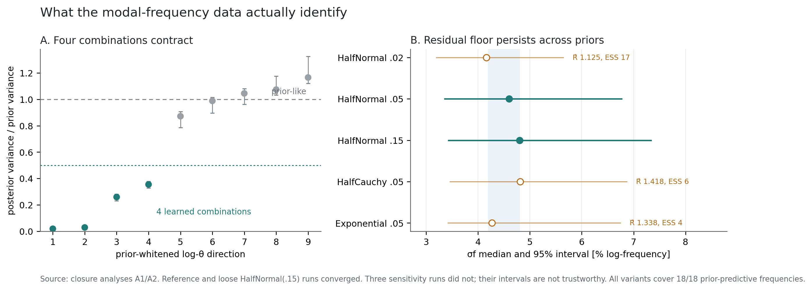

# Evaluating StatFEM on ShockSat: What I Tried, What Failed, and How to Close

**Advisor closure brief for Ilias Bilionis — Andrew Voss — 22 July 2026**

## Starting point and research sequence

The last project document you reviewed was my “Stress Testing StatFEM” proposal. Your guidance was to build and evaluate StatFEM, identify its gaps, and suggest improvements, while recognizing that validation might not be possible if the approach was not working.

I moved to NASA's public ShockSat article because its FEM, modal survey, and impact-hammer FRFs let me test the complete path from Bayesian updating to a load-related prediction. I first updated stiffness from modal frequencies, then tried response likelihoods and discrepancy models, then evaluated held-out FRFs and shear-load proxies. Persistent response errors led me to test changes to the FEM class itself.

## Bayesian methods tried

| Method | Data / likelihood or discrepancy | Inference | Why and outcome |
|---|---|---|---|
| Modal-frequency update | 18 paired frequencies; log-normal residual σf; 9 lognormal stiffness scales | NUTS, 4 chains | Converged baseline. Learns resonance locations, not channel amplitude or phase. |
| Frequency + MAC | Frequency likelihood plus MAC pseudo-likelihood | NUTS sensitivity arm | Tried to add shape information; 82 divergences, so no trustworthy posterior. |
| Beck-style shape inference | Frequencies and incomplete mode shapes with latent shape field | Prototype Bayesian update | Useful diagnostic; did not deliver the load objective. |
| Whole-FRF magnitude | 6,525 log-magnitude values, gains, residual scale, stiffness | NUTS | Direct response target; chains occupied separated modes (R-hat 44.7, ESS 2). |
| Complex FRF / phase | Magnitude plus phase from 46 channels and 12 modes | Diagnostic slice | Circular variance 0.854; no sharper parameter direction on the available single-hit data. |
| Time-domain damping | Decay data, modal damping ratios | NUTS | 14/16 modes converged; correcting damping raised peaks but did not repair response shape. |
| Modular working twin | Converged modal posterior plus zero-centered marginal log-amplitude discrepancy | Two-stage Monte Carlo | Retained predictive construction; calibrated mainly by widening. Not a joint StatFEM posterior. |
| M2 / inferred physics trust | Free response discrepancy or bounded physics-trust multiplier | TMCMC | Boundary-seeking or reproducible but over-wide; neither produced a sharp load product. |
| Modal evidence ranking | Squared frequencies + MAC; type-II ML residual scales | Local linearized evidence | +54.02 ranks model classes for the modal target, not held-out load prediction. |
| Schneider-style correlated surrogate | Frequency/space-correlated FRF discrepancy | Not implemented | Relevant literature-grounded alternative for future work. |

## The two Bayesian conclusions

For channel c and frequency f, the retained construction is

`z_c(f) = log |H_c(f)| = h_c(f; theta) + delta_c(f) + epsilon_c(f)`.

The implemented discrepancy has `E[delta_c(f)] = 0`. Therefore its predictive center is the parameter-updated FEM center; adding discrepancy increases predictive covariance but does not learn a channel- and frequency-dependent bias mean. This modeling choice does not show that mean correction is impossible. A structured nonzero mean over location and frequency could move the center. For example, it could represent a consistent low bias for one sensor region from 45–80 Hz. I did not implement or validate such a term.

**Why the updated center does not move enough toward the data.** The converged likelihood uses modal frequencies. It constrains four combinations of the nine stiffness groups, but it contains no channel-amplitude, phase, damping, or forcing-participation term. The retained zero-centered discrepancy cannot supply the missing mean correction. I have not proven that every residual component lies outside the span of the available parameter effects.

**Why the bands remain unusably large.** The observed FRF residual scatter is large and structured across channels and frequency. The retained marginal discrepancy transfers that scatter broadly to held-out channels. Coverage improves mainly by widening: in measured shear X/Y the total band is 1.508/2.301 times the FEM + 6 dB width, versus 1.068/1.215 for parameter uncertainty alone.

| Question | Answer |
|---|---|
| Did the prior alone prevent parameter movement? | **No.** Relative to prior variance 1.0, four prior-whitened directions contract to 0.019–0.355; five remain 0.872–1.166. A loose converged σf prior still gives a 4.80% residual floor. |
| Did modal updating improve held-out FRFs? | **Partly.** Across 775 channel/split cases, 595 improve; the median log-error changes only from 0.562 to 0.541. |
| Could a structured discrepancy move the predictive center? | **Yes.** A learned nonzero discrepancy mean could do so, but the implemented modular discrepancy is zero-centered. |
| Did the implemented discrepancy make the bands decision-useful? | **No.** It improves calibration and CRPS but is substantially wider than the baseline. |
| What remains unresolved? | Response mean/covariance structure, amplitude-identifiable likelihoods, direct load truth, generalization beyond one article, model-form selection, and whether an agent adds value. |

## Held-out FRF evidence

The four panels come from frozen split 10 and were selected by fixed rules: largest improvement, median improvement, largest remaining updated error, and largest deterioration. Across all 25 splits and 31 channels, 595/775 cases improve and 180 do not. Median mean absolute log10 error changes from 0.562 to 0.541; the total 5th–95th percentile interval covers 0.855 of channel/split cases. The center shown is the posterior median because the retained cache stores quantiles, not raw response draws.

The displayed channel errors are DAQ 20: 0.684 → 0.587; DAQ 53: 0.582 → 0.555; DAQ 24: 1.070 → 1.076; and DAQ 107: 0.581 → 0.661.

## Measured shear-load comparison

FEM + 6 dB is an engineering envelope, not a probability distribution. The continuous ranked probability score (CRPS) is a proper score for the full predictive cumulative distribution; it penalizes both distance from the measurement and excess spread. Lower CRPS is better. Values use the study's model-internal force units, so only relative comparisons are interpreted because the global gain is fitted. For CRPS, I converted the envelope three ways: uniform in log10 force between the edges (primary), uniform in linear force, and Gaussian in log10 force with the edges treated as a central 95% interval. Weighted coverage is the fraction of measured spectral bins inside the band under the study weighting; width is band GRMS divided by FEM + 6 dB band GRMS.

| Axis | FEM + 6 dB coverage; width | Parameter-only coverage; width | Parameter + discrepancy coverage; width | CRPS baseline → updated |
|---|---:|---:|---:|---:|
| Shear X, 5 measured held-out drives | 0.865; 1.000 | 0.984; 1.068 | 0.995; 1.508 | 1.252 → 1.137 |
| Shear Y, 5 measured held-out drives | 0.706; 1.000 | 0.947; 1.215 | 0.982; 2.301 | 0.771 → 0.709 |

The discrepancy-aware method beats FEM + 6 dB in 8/10 measured drive-axis cells under all three probability conventions. This is better calibration and average probabilistic score, but not a sufficiently sharp industry-ready band.

The +54.02 approximate log-evidence result and the held-out comparison answer different questions. Bayesian marginal likelihood integrates the likelihood over the parameter prior. This calculation instead uses a local linearization of the FEM and optimizes residual scales by type-II maximum likelihood rather than integrating them. The +54.02 value is therefore an approximate conditional ranking with no Monte Carlo error estimate or approximation-error bound. The held-out comparison asks whether the resulting prediction generalizes to withheld response/load evidence. The evidence winner remained top across three prior widths but did not deliver the best held-out engineering prediction.

## Why I pivoted to agentic remodeling

Parameter updating changes values inside a fixed FEM class. The response residuals motivated tests of connectivity, mesh density, element formulation, geometry, and regional parameterization. “Agentic remodeling” is a bounded loop: propose a registered edit; build the candidate FEM; verify mechanics; fit continuous parameters; score held-out data; diagnose; revise. Deterministic code owns construction, checks, data splits, budgets, and final scoring.

All four tested model-form families had positive class-mean controls. The study did not demonstrate an agent advantage: agent minus equal-budget random was -0.0077 +/- 0.0177 for the preregistered best-exact comparison and +0.0028 +/- 0.0056 for the track mean. Model-form freedom helped within the tested operators; agent guidance did not outperform random search.

## Work to preserve and guidance needed

| Work completed | Where explained | Limit |
|---|---|---|
| Chronological comparison of Bayesian updates and discrepancy choices | Sections 2–3 | Several response-level posteriors did not converge. |
| Modal identifiability and σf prior sensitivity | Section 3; Appendix A | Four learned combinations, not nine identifiable raw parameters. |
| Held-out FRF prediction with separated bands | Section 4 | Zero-centered marginal discrepancy; one ShockSat article. |
| Matched measured-shear comparison against FEM + 6 dB | Section 5 | Improved calibration costs sharpness; no direct net-CG truth. |
| Exact-basis model-form pilot with random control | Section 6 | No demonstrated agent advantage. |

I have less than one month left in my PSL studies. What is the best way to bring this project to closure? I want to capture the right personal lessons about why it fell short, whether I chose the wrong problem or direction at the outset, and which contributions merit documentation for the field and our lab.

### How this fits the literature

Mottershead and colleagues [2–3] limit parameter updating to mechanisms represented in the chosen FEM class. Girolami et al. [5] formulate StatFEM as probabilistic synthesis of model and observation, while Brynjarsdottir and O'Hagan [6] and Kennedy and O'Hagan [12] show how flexible discrepancy can confound physical parameters. The contribution worth considering here is a reproducible real-article evaluation that connects those known issues to held-out FRF and load sharpness, then tests model-form editing with a controlled random comparator. It is not a new general Bayesian method.

## Appendix A: modal posterior and prior sensitivity

The reference HalfNormal(0.05) run reproduces σf = 4.60% versus 4.63% stored, with worst R-hat 1.009 and minimum ESS 464. A loose converged HalfNormal(0.15) gives 4.80%. Three other sensitivity variants did not converge; their intervals are not trustworthy. Every prior-predictive variant covers 18/18 frequencies.

## References

1. NASA Engineering and Safety Center Academy. ShockSat. https://nescacademy.nasa.gov/workshops/ShockSat
2. Mottershead, J. E., & Friswell, M. I. (1993). Model Updating in Structural Dynamics: A Survey. *Journal of Sound and Vibration*, 167(2), 347–375. https://doi.org/10.1006/jsvi.1993.1340
3. Mottershead, J. E., Link, M., & Friswell, M. I. (2011). The sensitivity method in finite element model updating: A tutorial. *MSSP*, 25(7), 2275–2296. https://doi.org/10.1016/j.ymssp.2010.10.012
4. Beck, J. L., & Katafygiotis, L. S. (1998). Updating Models and Their Uncertainties. I. *Journal of Engineering Mechanics*, 124(4), 455–461. https://doi.org/10.1061/(ASCE)0733-9399(1998)124:4(455)
5. Girolami, M., Febrianto, E., Yin, G., & Cirak, F. (2021). The statistical finite element method for coherent synthesis of observation data and model predictions. *CMAME*, 375, 113533. https://doi.org/10.1016/j.cma.2020.113533
6. Brynjarsdottir, J., & O'Hagan, A. (2014). Learning about physical parameters: the importance of model discrepancy. *Inverse Problems*, 30(11), 114007. https://doi.org/10.1088/0266-5611/30/11/114007
7. Mthembu, L., Marwala, T., Friswell, M. I., & Adhikari, S. (2011). Model selection in finite element model updating using the Bayesian evidence statistic. *MSSP*, 25(7), 2399–2412. https://doi.org/10.1016/j.ymssp.2011.04.001
8. Vehtari, A., Gelman, A., & Gabry, J. (2017). Practical Bayesian model evaluation using leave-one-out cross-validation and WAIC. *Statistics and Computing*, 27, 1413–1432. https://doi.org/10.1007/s11222-016-9696-4
9. Hoffman, M. D., & Gelman, A. (2014). The No-U-Turn Sampler. *JMLR*, 15, 1593–1623. https://www.jmlr.org/papers/v15/hoffman14a.html
10. Vehtari, A., Gelman, A., Simpson, D., Carpenter, B., & Bürkner, P.-C. (2021). Rank-normalization, folding, and localization: An improved R-hat. *Bayesian Analysis*, 16(2), 667–718. https://doi.org/10.1214/20-BA1221
11. Schneider, R., Papaioannou, I., & Straub, D. (2022). Bayesian parameter updating in linear structural dynamics with frequency transformed data using rational surrogate models. *MSSP*, 166, 108407. https://doi.org/10.1016/j.ymssp.2021.108407
12. Kennedy, M. C., & O'Hagan, A. (2001). Bayesian calibration of computer models. *JRSS B*, 63(3), 425–464. https://doi.org/10.1111/1467-9868.00294
13. ASME V&V 10-2019 (R2025). *Standard for Verification and Validation in Computational Solid Mechanics*. https://www.asme.org/codes-standards/find-codes-standards/standard-for-verification-and-validation-in-computational-solid-mechanics
