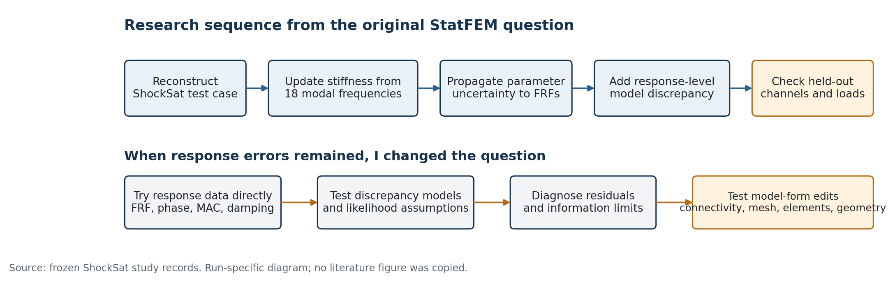
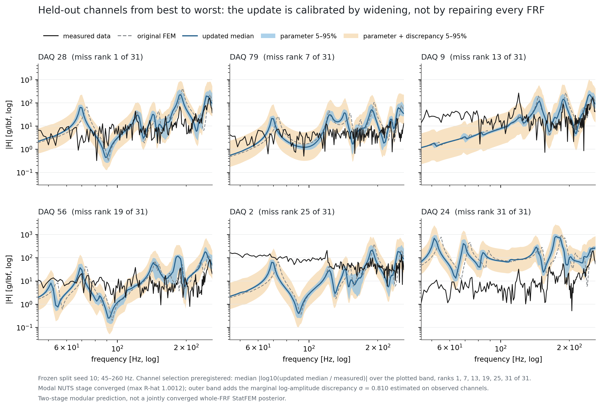
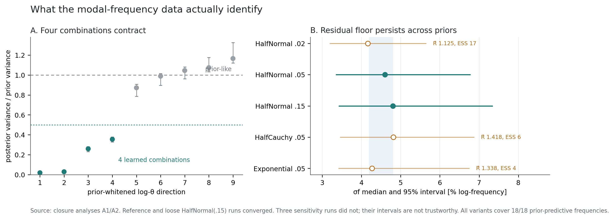

# Evaluating StatFEM on ShockSat: What I Tried and What I Need Help Deciding

**Advisor closure brief for Ilias Bilionis — Andrew Voss — 22 July 2026 (revised)**

## The two sentences that summarize the outcome

1. **The posterior mean does not move enough toward the data because** the only converged likelihood sees modal frequencies — it has no mechanism that can raise or lower a specific channel's amplitude in a specific frequency band, and only four of nine prior-whitened stiffness combinations are learned — and because the discrepancy term I added afterward was zero-mean by construction, so it could widen the predictive band but never shift the mean.
2. **The uncertainty bands remain unusably large because** that zero-mean, single-scale discrepancy can achieve coverage only by being wide everywhere. The parameter-only bands are already near baseline width yet under-cover, so the discrepancy must absorb channel-dependent structural error, and width is the only currency it has.

A discrepancy with a structured mean over sensor location and frequency band — "sensors at this location need higher amplitude in the 20–80 Hz range" — could move the mean instead of widening the band. I did not implement or test that, so its failure is not established. Sections "What the modal update showed" and "Load result" give the evidence for both sentences.

## Where this work started

The last project document you reviewed was my “Stress Testing StatFEM” proposal. Your guidance was: build and evaluate the StatFEM approach, identify its gaps, and suggest improvements. You also cautioned that validation might not be possible if the method itself was not working. I treated that as the research question.

The proposal aimed to update an aerospace finite-element model from vibration data, represent the difference between the FEM and the real structure, and propagate both sources of uncertainty to a structural load. I moved to NASA's public ShockSat test article because it offered a realistic FEM, a modal survey, and impact-hammer response data on the same structure.

I have less than one month remaining in my PSL studies. I want your direction on how to close this work, what I should learn from the problem choice, and which parts merit documentation for the field and the lab.

## How the work evolved

| Step | Why I did it | What I tried |
|---|---|---|
| 1. Establish a real test case | The earlier synthetic and small-model examples could test software, but they could not expose the problems created by a realistic aerospace FEM and sparse test data. | Reconstructed the ShockSat FEM/test alignment and defined modal, FRF, held-out-response, and load quantities. |
| 2. Start with modal updating | Natural frequencies offered the cleanest common observable between the FEM and test. This stage also checked the FEM assembly and Bayesian sampler before adding response discrepancy. | Inferred nine stiffness-group scales and a residual frequency-error scale from 18 paired modes using NUTS. |
| 3. Move to response-level StatFEM | Modal frequencies do not determine channel amplitudes, phase, damping, or forcing participation. The original objective required response prediction. | Tested whole-FRF magnitude, phase, MAC/shape, damping, Beck-style shape inference, and several discrepancy formulations. |
| 4. Test prediction rather than fit | A posterior fit to the data used for updating would not show whether the method supports an engineering decision. | Held out response channels and drive locations, propagated predictions to a load proxy, and compared them with the existing FEM + 6 dB practice. |
| 5. Investigate model form | The fixed nine-parameter FEM class could move resonance frequencies but left channel-dependent response errors. | Tested changes to connectivity, mesh density, element formulation, and geometry, then compared an agent-guided search with equal-budget random search. |

## What I modeled and measured

| Term | Definition used here |
|---|---|
| FEM / StatFEM | Finite-element model / statistical finite-element method. StatFEM treats the FEM prediction, model discrepancy, and observation process as one probabilistic data-generating model. |
| FRF / H1 | Frequency-response function; here accelerance magnitude, response acceleration divided by impact force, in g/lbf. H1 is the force-referenced estimator. |
| NUTS / R-hat / ESS | No-U-Turn Sampler; a gradient-based Hamiltonian Monte Carlo method. R-hat compares between- and within-chain variation; effective sample size (ESS) estimates independent-equivalent draws. Convergence criterion: R-hat no greater than 1.05, ESS at least 200, divergence fraction below 2%. |
| CRPS | Continuous ranked probability score: a proper score that compares an entire predictive distribution with one observed value; it rewards both closeness to the observation and honest spread. Lower is better. Reported here in the load's units. |
| IFT / β | “Inferred physics trust” comparator; β is its bounded physics-trust multiplier. This TMCMC arm was reproducible but produced over-wide band GRMS and is not the delivered method. |
| Model-form score | P1-prime: median per-channel Pearson correlation of log10 FRF magnitude below 200 Hz, averaged over four leave-one-drive-out folds; unitless. |
| Counts and bands | Modal update: 18 paired frequencies, 9 stiffness scales, 4 NUTS chains by 1,000 retained draws. Whole-FRF diagnosis: 6,525 log-magnitude points from 3 training drives, 45–400 Hz. Working-twin figure: one article, frozen split seed 10, six held-out channels chosen by a preregistered miss-rank rule, 45–260 Hz, 5th–95th percentile bands. Load comparison: five measured held-out drives per shear axis; normal-Z is synthetic self-consistency only. |

## Bayesian model used for the first update

For modal pair m, the implemented likelihood was `log f_meas,m ~ Normal(log f_pred,m(theta), sigma_f)`. This is one likelihood formulation out of eight I implemented — modal frequency; frequency + MAC; iid whole-FRF magnitude; phase/complex FRF; time-domain damping; Beck-style shape field; free response discrepancy; bounded physics trust — and it is the only one that passed the convergence gate. The full inventory with each formulation's outcome is the “Response methods I tried” table below. The nine positive stiffness scales had lognormal priors centered at the inherited FEM. The primary run inferred those scales and the iid log-frequency residual sigma_f with NUTS. It used modal frequencies, not FRF amplitudes, and did not use MAC as a generative shape likelihood.

This first model estimates stiffness from modal frequencies. It cannot learn channel-specific response amplitude, phase, or forcing participation because those quantities do not enter its likelihood. I therefore treated modal updating as the first stage of the StatFEM evaluation, then tested response likelihoods and discrepancy models separately.

## Research sequence

## What the modal update showed

The update converged and did real work in every direction it could see. The direct answers:

| Bayesian question | Answer |
|---|---|
| Did the prior simply prevent movement? | **No.** The data contract four prior-whitened log-stiffness combinations to posterior/prior variance ratios 0.0187, 0.0286, 0.2593, and 0.3546; the remaining five directions stay prior-like at 0.8718–1.1657. The data moved everything it could see. This is a subspace result, not nine separately identifiable parameters. |
| Was sigma_f forced by its prior? | **No.** The frozen HalfNormal(0.05) reference reproduces sigma_f = 4.60% versus 4.63% stored (worst R-hat 1.009, minimum ESS 464). A looser converged HalfNormal(0.15) gives 4.80%. Across all five priors the medians span 4.16–4.82%. |
| Are the predictive checks obviously inconsistent? | **No.** All five prior-predictive variants cover 18/18 frequencies, and the reference posterior-predictive PIT (probability integral transform: where each observation falls inside its own predictive distribution; ideally uniform) spans 0.079–0.906 without boundary pile-up. |
| What remains unresolved? | **Three things, at the scale of the whole project:** whether a structured-mean discrepancy could move response predictions (never tested); whether any response-level likelihood yields a converged, decision-grade posterior on this article; and whether model-form editing beats parameter updating. Within this table's narrower scope: three of five sensitivity chains fail convergence, so their intervals are not trustworthy, and I interpret the modal result only at the level of parameter combinations. |

Figure A1 in Appendix A shows the prior-whitened subspace and the sigma_f prior-sensitivity detail behind this table.

### Why the mean cannot move — and what could still move it

The converged likelihood sees 18 modal frequencies. Moving a resonance is the only way it can change any FRF, and only four stiffness combinations are learned from the data. Nothing in the model can express “the sensors at this location need higher amplitude between 20 and 80 Hz.” The discrepancy added at the prediction stage was zero-mean by construction: it can widen the band, never shift the mean. That is a modeling choice, not a law. A discrepancy with a structured mean over sensor location and frequency — exactly the mechanism the residuals suggest — could move the mean toward the data, and I did not implement or test it. So the honest statement is: the mean does not move because the converged likelihood has no amplitude mechanism and the chosen discrepancy was zero-mean, not because moving the mean has been shown impossible.

## Response-level StatFEM attempts and recovered diagnostics

The iid whole-FRF likelihood used 6,525 log-magnitude observations, per-drive gains, a residual scale, and nine stiffness scales. With gains and residual scale profiled at each of 41 points, the two most sensitive parameter slices each contain about 10 local maxima. The stored chains occupy different modes (worst R-hat 44.7, ESS 2.0). That is evidence of global under-identification/multimodality for this likelihood, not proof that response-level StatFEM is generally invalid.

The original phase diagnostic was found rather than re-derived. On one single-hit dataset (46 channels, 12 matched modes), circular variance was 0.854 and the complex parameter slice was no sharper than magnitude. A separate time-domain damping study did converge for 14/16 modes (worst R-hat 1.020, minimum ESS 250; damping 0.33–0.76% of critical), but replacing the nominal damping did not solve the envelope decision. The FEM was more heavily damped than the measured article, so the correction raised peaks; response-shape error remained binding.

### Response methods I tried

| Method | Data and Bayesian target | Why I tried it | Result and limitation |
|---|---|---|---|
| Modal-frequency NUTS | 18 paired log frequencies; 9 stiffness scales plus sigma_f | Establish a stable parameter-updating baseline before adding response discrepancy | Converged reference; it estimates FEM parameters from modal frequencies |
| Frequency + MAC arm | Modal frequencies plus a MAC pseudo-likelihood | Test whether mode-shape agreement adds information beyond frequencies | 82 divergences in the original arm; sensitivity study only |
| Beck-style inferred shape field | Modal frequencies/shapes with the shape field itself inferred | Test whether allowing the measured shape field to move could sharpen response amplitudes | Useful amplitude/shape diagnostic; did not support the load objective |
| Modular working twin | Converged modal posterior, then observed-channel marginal discrepancy | Propagate the stable parameter posterior while acknowledging remaining response error | Two-stage construction; the discrepancy was not sampled jointly with the parameters |
| iid whole-FRF NUTS | Whole log-magnitude curves; stiffness, gain, residual | Use the response curves directly instead of modal summaries | Not converged; no trustworthy joint interval |
| Free-discrepancy M2 / bounded IFT | TMCMC alternatives for a response discrepancy / physics-trust term | Test free and bounded ways of allocating error between parameters and discrepancy | Neither produced a sharp, validated load product |
| Evidence ranking | Matched squared frequencies plus MAC; type-II ML residual scales | Compare FEM classes under the same modal target | +54.02 was an approximate ranking diagnostic, not held-out validation |
| Schneider-style correlated FRF surrogate | Frequency/space-correlated error with rational surrogate | Consider a literature-grounded way to model correlated FRF error | Not implemented in this project |

## The retained working twin

Channel selection was fixed before plotting: rank the 31 held-out channels of frozen split seed 10 by the median of |log10(updated median / measured)| over 45–260 Hz, and show ranks 1, 7, 13, 19, 25, and 31. The inner blue band propagates the converged modal-parameter posterior; the outer amber band adds a marginal log-amplitude discrepancy estimated on observed channels and transferred to held-out channels. The best-ranked channels track the measurement closely. By the middle ranks the updated median already departs from the data over parts of the band. At the worst ranks the outer band envelopes a structurally wrong mean — and enveloping is not repairing the FEM.

The posterior mean moves only as far as the information and mechanisms in the modal likelihood allow; a stronger or weaker discrepancy prior cannot add missing channel physics. The band is wide because the observed response mismatch requires a large discrepancy, not because NUTS failed in the first stage. A structured discrepancy could redistribute that uncertainty — and a structured discrepancy mean could remove some of it — but orthogonal discrepancy, coherence-derived covariance, and the Schneider surrogate remain unimplemented future options.

## Load result: calibration versus usefulness

CRPS below is the continuous ranked probability score defined in the terms table: it scores the entire predictive distribution against the measured value; lower is better. Normal-Z results are in Appendix B because that axis is synthetic self-consistency and is not relevant to the central finding.

| Axis / evidence | FEM + 6 dB coverage; width | Parameter-only coverage; width | Discrepancy-aware coverage; width | Measured CRPS: baseline -> discrepancy-aware |
|---|---:|---:|---:|---:|
| Shear X, measured held-out drives | 0.865; 1.000 | 0.984; 1.068 | 0.995; 1.508 | 1.252 -> 1.137 |
| Shear Y, measured held-out drives | 0.706; 1.000 | 0.947; 1.215 | 0.982; 2.301 | 0.771 -> 0.709 |

Coverage rises, and the discrepancy-aware method has lower mean CRPS than FEM + 6 dB on both measured shear axes. It wins 8/10 measured drive-axis cells under all three baseline-envelope probability conventions. The method achieves this calibration with bands 1.51 times the baseline width in shear X and 2.30 times in shear Y. That width still prevents industry use.

Why wide: parameter uncertainty is not the driver — the parameter-only bands are 1.068 and 1.215 times baseline yet under-cover. The zero-mean marginal discrepancy must absorb channel-dependent FRF shape and participation errors that nine stiffness scales cannot express, and a single broad scale can achieve coverage only by being wide everywhere. A structured discrepancy might allocate uncertainty where the error lives — and a structured discrepancy mean might remove part of it — but neither was implemented.

### What the evidence comparison measured, in more detail

The +54.02 result is a difference in log Bayesian evidence (marginal likelihood). Evidence is the probability a model class assigns to the observed data after averaging over its prior, so it trades fit against flexibility rather than rewarding fit alone. A difference of +54.02 in natural-log units says the winning class makes the matched modal data about e^54 times more probable than the baseline class — decisive if taken at face value. Three caveats prevent taking it at face value. First, it uses a local linearization of the FEM around a point, so the number is a Laplace-style approximation that is only trustworthy if the posterior is close to Gaussian there. Second, it carries no Monte Carlo or approximation error bar, so the reported magnitude cannot be separated from approximation error. Third, it is conditional on one specific target — matched squared frequencies plus MAC, with residual scales set by type-II maximum likelihood, meaning those scales were chosen by maximizing rather than integrated over. It therefore ranks model classes for that modal target only. It says nothing about held-out response or load prediction; the load section above answers that separate question, and the two kinds of comparison can disagree.

| What improved | What did not |
|---|---|
| Measured shear coverage and average CRPS | Sharpness; direct net-CG force validation; normal-Z answer key |
| Calibration across three baseline probability conventions | Build-to-build, flight-to-flight, and forcing variability |

## Why I pivoted to model-form remodeling

Parameter updating changes values inside a fixed FEM class. The residual evidence instead pointed to missing or wrong response mechanisms: channel-dependent participation, interface representation, element formulation, geometry idealization, and local shape fidelity. “Agentic remodeling” therefore means a bounded loop over registered model-form edits: propose -> build -> verify mechanics -> fit continuous parameters -> score held-out data -> diagnose -> revise. The agent proposes; deterministic code owns mesh construction, mechanical checks, data splits, budgets, and scoring.

The pilot tested connectivity, mesh density, element formulation, and geometry with exact candidate-basis scoring. All four classes had positive class-mean controls. However, this study failed to demonstrate an agent advantage. The preregistered primary comparison was best-exact versus best-exact: agent minus random = -0.0077 +/- 0.0177 in unitless score, below the one-standard-error minimum detectable effect of 0.0177. The secondary track-mean difference was +0.0028 +/- 0.0056 and also did not clear its bar. Model-form freedom was a useful lever in this pilot. The agent-guided search did not outperform the equal-budget random search.

The future harness is a CLI-mediated version of this same loop, with versioned candidate and diagnostic schemas and immutable verifier controls. `remodelctl` is not yet the scientific contribution and is not required to close the ShockSat result. It is a possible way to make later agent training reproducible.

## Work products I could preserve, with their limits

| Work product | Where explained | Limit that must travel with it |
|---|---|---|
| A real-data separation between converged modal-frequency Bayesian updating and non-converged response-level inference | “What the modal update showed”; “Response-level StatFEM attempts” | One ShockSat article; no build-to-build or flight-to-flight variability |
| Prior-whitened subspace diagnosis showing four learned combinations | “What the modal update showed”; Appendix A | Not nine raw-parameter identifiability claims |
| Prior-sensitivity analysis showing that the modal residual floor survives a loose converged prior | Appendix A | Three of five sensitivity variants did not converge |
| A modular predictive construction that separates parameter and output-discrepancy bands | “The retained working twin” | Wide marginal discrepancy; not a joint StatFEM posterior |
| Matched coverage and proper-score comparison against FEM + 6 dB | “Load result”; Appendix B | Normal-Z has no measured answer key; shear gain costs width |
| A controlled model-form search with exact-basis and random controls | “Why I pivoted to model-form remodeling” | Positive model-form classes, but no demonstrated agent advantage |

Classical FEM-updating literature limits parameter correction to mechanisms represented by the chosen model class [2–3]. StatFEM and computer-model calibration add discrepancy, while flexible discrepancy can confound physical parameters and widen prediction [4–6]. Held-out prediction answers a different question from conditional marginal likelihood [7–8]. NUTS diagnostics determine whether the reported Monte Carlo intervals can be trusted [9–10]. Schneider's correlated-error surrogate offers one possible next method; I did not implement it [11].

## Guidance I need for the final month

i've got less than a month until I'm done with my PSL studies. What is the best way to bring it to closure? I want to make sure I capture the right lessons learned from this personally on if/why it failed and if I embarked on the wrong direction/problem at the outset, and make sure I make sure I document any meaningful contributions i've made to this field and the research of our lab.

## Appendix A. Modal identification detail

The four contracted prior-whitened log-stiffness directions have posterior/prior variance ratios 0.0187, 0.0286, 0.2593, and 0.3546. They are dominated by bottom/top box, plates, and cross-beam combinations. The remaining five directions are prior-like (0.8718–1.1657). This is a subspace result; it does not establish nine separately identifiable parameters.

The frozen HalfNormal(0.05) reference reproduces sigma_f = 4.60% versus 4.63% stored, with worst R-hat 1.009 and minimum ESS 464. A looser converged HalfNormal(0.15) gives 4.80%. Across all five priors the medians span 4.16–4.82%, and every prior predictive check covers 18/18 frequencies. Three sensitivity runs did not converge; their intervals are not trustworthy.

## Appendix B. Normal-Z evidence status

Normal Z, synthetic self-consistency only: baseline FEM + 6 dB coverage 0.738 (width 1.000); parameter-only 0.969 (width 1.016); discrepancy-aware 0.987 (width 2.526); no measured validation exists for this axis. The delivered reference width is 2.526 times FEM + 6 dB. The later tier-updated configuration is 2.958 because observed cross-drive log-amplitude scatter (1.393) exceeded the assumed unmeasured-tier value (0.80); these are different configurations, not inconsistent reproductions. Normal-Z remains synthetic self-consistency, not validation.

## References

1. NASA Engineering and Safety Center Academy. *ShockSat*. https://nescacademy.nasa.gov/workshops/ShockSat
2. Mottershead, J. E., & Friswell, M. I. (1993). Model Updating in Structural Dynamics: A Survey. *Journal of Sound and Vibration*, 167(2), 347–375. https://doi.org/10.1006/jsvi.1993.1340
3. Mottershead, J. E., Link, M., & Friswell, M. I. (2011). The sensitivity method in finite element model updating: A tutorial. *MSSP*, 25(7), 2275–2296. https://doi.org/10.1016/j.ymssp.2010.10.012
4. Beck, J. L., & Katafygiotis, L. S. (1998). Updating Models and Their Uncertainties. I. *Journal of Engineering Mechanics*, 124(4), 455–461. https://doi.org/10.1061/(ASCE)0733-9399(1998)124:4(455)
5. Girolami, M., Febrianto, E., Yin, G., & Cirak, F. (2021). The statistical finite element method for coherent synthesis of observation data and model predictions. *CMAME*, 375, 113533. https://doi.org/10.1016/j.cma.2020.113533
6. Brynjarsdottir, J., & O'Hagan, A. (2014). Learning about physical parameters: the importance of model discrepancy. *Inverse Problems*, 30(11), 114007. https://doi.org/10.1088/0266-5611/30/11/114007
7. Mthembu, L., Marwala, T., Friswell, M. I., & Adhikari, S. (2011). Model selection in finite element model updating using the Bayesian evidence statistic. *MSSP*, 25(7), 2399–2412. https://doi.org/10.1016/j.ymssp.2011.04.001
8. Vehtari, A., Gelman, A., & Gabry, J. (2017). Practical Bayesian model evaluation using leave-one-out cross-validation and WAIC. *Statistics and Computing*, 27, 1413–1432. https://doi.org/10.1007/s11222-016-9696-4
9. Hoffman, M. D., & Gelman, A. (2014). The No-U-Turn Sampler. *JMLR*, 15, 1593–1623. https://www.jmlr.org/papers/v15/hoffman14a.html
10. Vehtari, A., Gelman, A., Simpson, D., Carpenter, B., & Bürkner, P.-C. (2021). Rank-normalization, folding, and localization: An improved R-hat. *Bayesian Analysis*, 16(2), 667–718. https://doi.org/10.1214/20-BA1221
11. Schneider, R., Papaioannou, I., & Straub, D. (2022). Bayesian parameter updating in linear structural dynamics with frequency transformed data using rational surrogate models. *MSSP*, 166, 108407. https://doi.org/10.1016/j.ymssp.2021.108407
12. Kennedy, M. C., & O'Hagan, A. (2001). Bayesian calibration of computer models. *JRSS B*, 63(3), 425–464. https://doi.org/10.1111/1467-9868.00294
13. ASME V&V 10-2019 (R2025). *Standard for Verification and Validation in Computational Solid Mechanics*. https://www.asme.org/codes-standards/find-codes-standards/standard-for-verification-and-validation-in-computational-solid-mechanics
