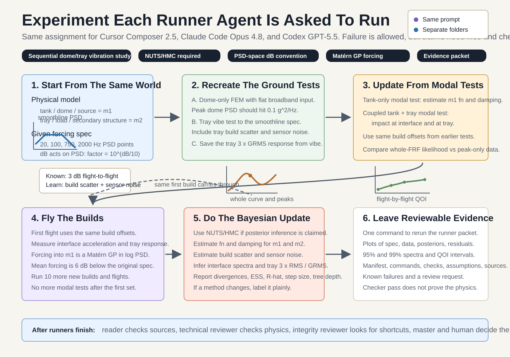

# Runner Experiment Infographic

This infographic describes the experiment each runner agent is being asked to attempt in the competitive full-experiment pressure test.

It is not a result and does not claim that any runner has completed the work. It is a shared description of the assignment.

## Plain-English Summary

Each runner gets the same structural-dynamics problem: tank/dome/source as `m1`, tray/load/secondary structure as `m2`, PSD-space dB inputs, staged ground tests, flights, NUTS/HMC posterior inference, plots, checks, and an evidence packet.

The runners are allowed to fail. The important thing is that each runner leaves enough files for the human, master agent, checker, reader, and reviewers to see what happened.
